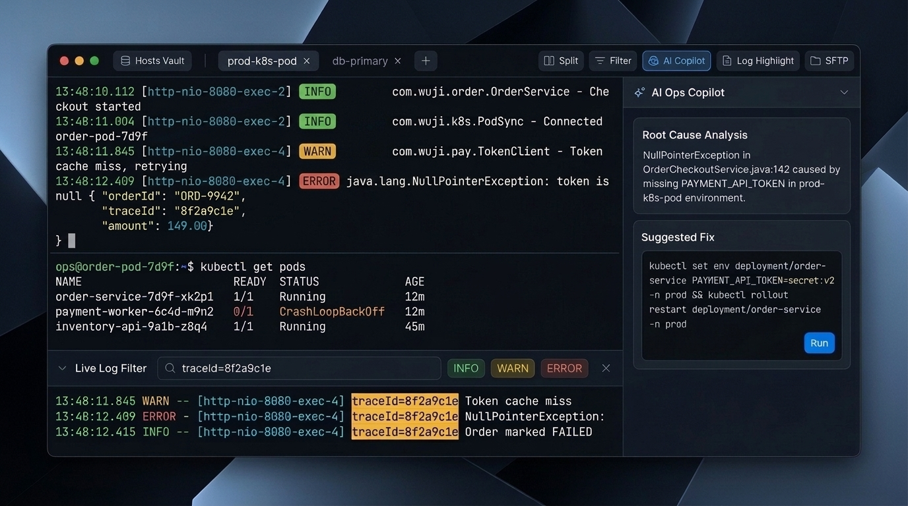

<div align="center">


# WujiTerm（无极终端）

**面向现代研发、运维与 SRE 的下一代高性能智能终端与一体化运维工作台**

*告别多工具反复切换，一站式整合 SSH 终端、多层堡垒机自动化、K8S 实时日志排障、实时系统监控、命令块状交互、AI 运维副驾驶、SQL & Redis 工作台、Windows RDP / 跨平台 VNC 远程桌面、免权限用户态 VPN、穿透式文件传输与端到端加密多端同步*

[](https://github.com/smxj1314/wuji-term/releases/tag/v0.6.1)
[](https://github.com/smxj1314/wuji-term/releases/latest)
[](#为什么选择-wujiterm)
[](#九企业级安全审计与加密多端同步)
[](#开源协议)

**简体中文** | **[English](README_EN.md)**

[产品亮点](#为什么选择-wujiterm) · [界面一览](#界面一览) · [全量功能详解](#全量核心功能与特色详解) · [快捷键速查](#常用快捷键速查) · [命令行工具](#十wuji-命令行工具与私有化同步) · [下载安装](#下载与安装)

</div>

---

## 为什么选择 WujiTerm？

在真实的研发与线上排障现场，工程师通常要在 **SSH 终端、跳板机登录脚本、日志分析工具、JSON/SQL 格式化网站、Diff 对比工具、数据库客户端、Redis 客户端、RDP/VNC 远程桌面、公司 VPN 客户端、SFTP 文件工具、AI 问答网页** 之间反复切换。工具割裂不仅打断排障思路，面对海量业务日志刷屏时也常常卡顿、掉帧、占用极高内存。

**WujiTerm（无极终端）** 专为高频研发与运维场景打造，是一款原生高性能桌面终端与综合工作台——启动迅速、内存占用极低、海量日志刷屏依然丝滑顺畅，将日常终端会话、线上排障、数据库查询、Windows/VNC 远程桌面、按需 VPN 穿透、文件收发与 AI 诊断全链路能力浓缩进同一个清爽高效的界面中：

| 核心场景 | 传统多工具拼装体验 | WujiTerm（无极终端） |
| :--- | :--- | :--- |
| **高吞吐日志与流畅度** | 日志刷屏易卡顿、掉帧、发热耗电 | **原生硬件加速渲染**，高吞吐日志顺滑流畅，静置极低能耗 |
| **多层堡垒机 & K8S 登录** | 每次手动挑节点、输密码、选 Pod 序号、敲日志命令 | **可复用跳板机继承 + 自动登录流水线 + 智能优选 Running 容器** |
| **线上日志排障与监控** | 肉眼翻屏、全屏 `grep` 断流、无 `htop` 难以看负载 | **日志高亮 + 不断流 `TraceId` 过滤抽屉 + 8 大格式解析 + 双栏 Diff + 内置可视化 `htop` 监控** |
| **现代终端交互** | 命令行输入难以鼠标定位、报错无结构化归档 | **命令块状输出（Blocks）+ 多行智能输入栏 + 全快捷键自定义 + 跨会话历史检索** |
| **数据库与文件运维** | 另装数据库工具 / Redis 工具 / SFTP 工具 | **原生内置 MySQL / PG / SQL Server / ClickHouse / Redis 工作台 + SFTP & 容器直传** |
| **Windows & VNC 远程桌面** | 另装 RDP / VNC 客户端，内网需手动搭隧道、传文件繁琐 | **标签页原生内嵌 RDP / VNC 远程桌面 + WinRM 加密终端 + 共享盘/剪贴板双向传文件** |
| **企业内网 VPN 接入** | 系统 VPN 劫持全局路由、影响日常上网、需管理员权限 | **免管理员权限纯用户态 L2TP / IPSec VPN + 本地 SOCKS5 代理 + 全资产一键按需穿透** |
| **AI 运维协同** | 复制报错切网页问 AI，易泄露 Token / 生产数据 | **内置多模型 AI 副驾驶**，报错自动感知、发送前自动脱敏、自然语言直出 Shell 命令 |
| **安全与多端同步** | 明文配置或强绑定第三方云账号 | **系统钥匙串 / 本地加密保险库 + 生产高危防火墙 + 多云/自建加密同步** |

---

## 界面一览

### 1. 统一主机资产库与跳板机中心（Hosts Vault）
> 一体式沉浸顶栏（窗口控制按钮与标签页合二为一）、左侧连接资产分类与主机分组自由手动排序、网格/列表双视图切换、可复用跳板机继承与多步骤自动化流水线。

<p align="center">
  
</p>

### 2. 智能终端、不断流日志过滤与 AI 运维副驾驶
> 支持任意方向嵌套分屏与多窗格广播输入、实时日志语法高亮、底部 `TraceId` 实时日志过滤抽屉，以及右侧 AI 报错根因分析与一键修复面板。

<p align="center">
  
</p>

### 3. 内置 SQL / Redis 数据工作台与 SFTP / 容器文件直传
> 在同一应用与标签体系内直接连接 MySQL / PostgreSQL / SQL Server / ClickHouse 与 Redis（带只读护栏与命名空间树），配合右侧 SFTP 与穿透式容器文件直传抽屉，实现排障、查库、导日志一站式闭环。

<p align="center">
  
</p>

---

## 全量核心功能与特色详解

### 一、流畅终端体验与一体式现代桌面设计

- **极速流畅与超低功耗**
  - 原生硬件加速渲染，完整支持 24-bit 真彩色与中英文宽字符精准居中对齐，面对海量日志输出依然保持丝滑流畅；窗口静置时极低资源占用，告别后台发热与耗电。
- **一体式沉浸顶栏（macOS & Windows 双端专属优化）**
  - **macOS**：红黄绿原生窗口控制按钮与顶部主机标签栏融为同一行，告别冗余标题栏留白；进入系统原生全屏时自动收起左侧间距。
  - **Windows**：将传统标题栏、菜单栏与标签栏精简合并为单行一体式顶栏——最左侧提供紧凑 `☰` 多级级联菜单，最右侧内嵌 `─ / □ / ✕` 窗口控制按钮，完整保留系统圆角阴影、八方向边缘缩放与分屏贴靠。
  - 顶栏空白区域支持**按住直接拖动窗口**与**双击最大化 / 还原**。
- **系统状态栏 / 托盘快速驻留与会话直达**
  - **macOS 顶部菜单栏**采用自适应明暗的单色模板图标，**Windows 系统托盘**提供原生托盘图标与在线状态指示；实时汇总全部活跃连接（终端、数据库、RDP/VNC 远程桌面、VPN 隧道与端口转发），点击即可一键唤起并聚焦至指定会话、断开连接或新建本地终端，支持在界面设置中随时开关且无需重启。
- **多模式标签页、密度切换与高度可定制工具栏**
  - **3 种标签栏布局模式 + 双密度切换**：支持单行横向滑动、末尾 `▾ 更多 (N)` 折叠下拉（自动保持当前会话可见）、以及多行平铺全部可见；并提供**宽松 / 紧凑**两种标签密度适配高频多会话场景。
  - **标签页固定与拖拽排序**：一键固定核心生产会话防止误关，支持按住鼠标直接拖拽重排顺序，右键支持「移至最左/最右」「关闭其它未固定标签」「关闭右侧未固定标签」。
  - **顶栏 `+` 按钮双模式交互**：左击默认打开本地终端，可在「界面配置」或右击菜单中自定义为**一键打开主机库中的任意指定主机**；**右击 `+` 随时弹出带实时搜索的完整主机列表**，左击直连或一键设为左击默认。
  - **工具栏风格与状态栏指标自由定制**：功能按钮支持**仅图标 / 仅文字 / 图标+文字**三种展示风格；顶部功能按钮（命令面板、分屏、命令块、实时过滤、系统监控、AI 副驾驶、折行、日志高亮、指令片段、搜索、文件传输、容器直传）及底部状态栏指标（终端尺寸、折行状态、字号、高亮、主机地址）均可逐项自由显隐。
- **超长日志双模式与精准鼠标交互**
  - **自动折行 / 单行横向滚动一键切换（`⌥Z` / `Alt+Z`）**：单行模式下提供底部横向滚动条，支持触控板横滑或 `Shift + 滚轮` 顺滑翻阅超长 JSON / 异常堆栈不断行。
  - **IDE 级鼠标交互**：点击命令行任意位置即可精准定位输入光标（兼容中英文混排与软折行）；支持双击选词、三击选整行、选中自动复制（可开关）、`⌘/Ctrl + 点击` 直接在浏览器打开链接。
- **自由嵌套分屏、窗格放大与多窗格广播输入**
  - 支持任意层级的左右分屏 / 上下分屏、单窗格临时最大化（Zoom Pane）、分屏焦点快速切换，以及**多窗格同步广播输入（Broadcast Input）**，一次敲命令同时下发至多个集群节点或容器。
- **全局命令面板、自定义右键菜单与全量快捷键录制**
  - 全局命令面板（`⌘P` / `Ctrl+Shift+P`）支持纯键盘秒级模糊搜索直达全部主机、Windows/VNC 桌面、VPN、数据库、Redis、快捷指令、应急诊断箱、终端主题与常用操作。
  - 终端右键菜单支持完全可视化定制（自由增删、排序、分割线、自定义一键发送命令）。
  - **可视化快捷键设置中心**：覆盖 27 项高频操作（导航、分屏、编辑、诊断/AI/监控、视图五大分类），支持按键实时录制、冲突自动检测与一键覆盖、单项禁用或恢复默认。

---

### 二、主机资产库与多层堡垒机 / K8S 自动化流水线

- **全类型连接资产统一纳管**
  - 统一管理 **SSH 远程主机、堡垒机/跳板机、自动化跳转主机、本地 Shell（自动发现本地可用终端）、Windows Server（RDP / WinRM / OpenSSH）、跨平台 VNC 远程桌面、MySQL / PostgreSQL / SQL Server / ClickHouse 数据库、Redis 缓存主机，以及内置用户态 VPN 隧道**，并自动实时聚合本地 SSH 配置别名。
- **可复用跳板机继承 & 前置 VPN 按需联动**
  - 将堡垒机或跳板机开启「**可作为跳板机复用**」属性后，所有下游内网机器与 K8S 容器在新建或编辑时只需一键勾选关联，即可**自动继承账号、加密口令与前置登录步骤**，同时支持**跳板机内跳转**与 **SSH 隧道跳转（`-J`）**两种模式。
  - 任意 SSH、本地终端、Windows/VNC 与数据库主机均可直接绑定**前置用户态 VPN**（并支持叠加 SSH 堡垒机实现双层穿透），点击主机卡片自动拉起对应 VPN 通道并直连目标服务。
- **可视化自动跳转与动态 K8S 容器优选**
  - 无需手写复杂脚本，通过可视化步骤列表即可编排自动登录、菜单选择、**步骤发送前等待延迟**（如 `1000ms`）与登录后自动执行的命令（如自动进入目标容器并执行 `hlog`）。
  - **智能动态匹配 `auto:服务名|兜底序号`**：自动识别堡垒机/K8S 交互菜单，按服务名动态定位并**优先选择 `Running` 状态的健康容器**，彻底告别发版重启后 Pod 序号变动导致登录失败的烦恼。
  - **全平台提示符智能兼容 & 快捷指令联动**：等待规则填 `shell` 即可自动兼容 macOS、Linux、Windows 各类命令行提示符；填 `立即`/`now` 可无等待直发；自动指令输入框可直接从「快捷指令库」下拉选取。
- **灵活的资产视图、分组与全维度手动排序**
  - 支持**卡片网格（Grid）与紧凑列表（List）双视图**、5 种排序方式（自定义顺序含 `↑/↓` 调序 / 名称 A→Z / Z→A / 地址 / 协议类型）、左侧资产导航一键折叠收起，以及多级目录分组（如 `生产环境/订单服务`）、原地重命名与折叠状态记忆。
  - **左侧「连接资产」分类与「主机分组」均支持手动调序**：同时提供 **按住上下直接拖动**、**点击 `⇅ 排序` 显示 `↑/↓` 按钮微调**、以及**右键菜单置顶/置底**三种方式；分组顺序全局同步至右侧筛选标签栏与分组区块。
- **高可用与生产级运维保障**
  - 主机级 **`PROD` 生产环境警示标识**、**断线自动重连**（带倒计时提示与随时取消）、**防踢心跳保活**，以及可配置的**启动应用默认行为**（进入主机库 / 打开本地终端 / 自动直连指定主机）。

---

### 三、研发与 SRE 专属排障工作台

- **智能终端：命令块状输出（Blocks）与多行输入栏**
  - **命令块状输出（Blocks）**：每次执行的命令与对应输出自动切分为独立区块，支持单块一键复制、单块脱敏复制、块内搜索过滤、折叠浏览与错误块一键召唤 AI 诊断。
  - **多行智能输入栏**：支持鼠标点击定位编辑、多行长命令编排、指令片段与远端文件/路径自动补全菜单，以及跨会话历史命令可视化全文检索弹窗（`⌘R` / `Ctrl+Shift+R`）。
- **内置实时系统监控抽屉（可视化 `htop`）**
  - 一键呼出（`⇧⌘M` / `Ctrl+Shift+M`）远端主机或本机的实时监控抽屉：展示 **CPU 实时趋势折线图、内存与 Swap 占用、系统负载与运行时长、各挂载点磁盘空间，以及可按 CPU / 内存 / PID 排序、搜索筛选并带安全二次确认终止（Kill）的实时进程表**。
  - 当在精简版容器或服务器上输入 `htop` 提示未安装时，自动浮现引导条，支持**一键在终端内启动零依赖、免安装、零落盘的内置彩色 `htop` 实时监控**（兼容 Ubuntu / CentOS / Alpine / K8S Pod / macOS）。
- **实时日志语法高亮**
  - 自动识别并着色时间戳、`INFO / WARN / ERROR / FATAL` 日志级别、Java 类名行号、JSON 键值、SQL 关键字、URL 与耗时指标，同时智能避让 `vim`、`htop`、`ls --color` 等应用自身色彩，互不干扰。
- **不断流实时日志过滤抽屉（`TraceId` 专注视图）**
  - 在 `tail -f` / `kubectl logs -f` 持续刷屏时，底部抽屉可实时按 `TraceId`、关键词或正则抽取匹配日志，支持 **`±N` 行上下文展示**与多色高亮标签，底层终端日志流全程不断流。
- **自定义输出触发器（Output Triggers）**
  - 实时监听终端输出内容，命中规则时自动触发**自定义醒目高亮、桌面弹窗通知提醒、或自动回复指令（支持高危二次确认闸门）**，并内置冷却防抖保护。
- **右键一键 8 大高频格式解析 + 自定义格式化脚本**
  - 框选终端任意内容即可智能识别并弹窗美化：
    1. **JSON** 缩进美化与结构化浏览；
    2. **SQL 美化与 `?` 占位参数自动还原**（一键将日志中的带参 SQL 还原为可直接执行的完整语句）；
    3. **Java / K8S 异常堆栈提纯**（高亮业务根因行，自动折叠冗长框架栈帧）；
    4. **Cron 表达式中文解析与未来 5 次触发时间推演**（同时兼容 Linux 5 位与 Spring 6 位）；
    5. **Unix 时间戳（秒 / 毫秒）与本地/UTC 时间双向转换**；
    6. **JWT Token 解码与过期时间校验**；
    7. **URL 解码与 Query 参数表格拆解**；
    8. **Base64 编解码还原**。
  - **自定义格式化规则**：支持零代码链式规则（如嵌套 JSON 解包、一键拼装 `SQL IN (...)`）或接入本地自定义脚本，直接挂载到终端右键菜单。
- **双栏报文 Diff 对比器**
  - 右键一键将选中文本设为基线（Diff A），再与任意新输出并排对比，支持 **JSON 自动按 Key 排序去噪对比**、SQL 规范化对比与纯文本行级差异高亮。
- **敏感信息一键脱敏复制**
  - 复制前自动掩码手机号、身份证号、邮箱、银行卡、Token、密码字段与内网 IP，发群求助或提工单安全无忧。
- **参数化快捷指令库 & 内置 SRE 应急诊断箱**
  - 支持 `{{param:默认值}}` 参数化指令模板，触发时自动预填当前选中的终端文本（如 Pod 名、TraceId、PID），确认后一键下发。
  - 内置 **Java（CPU / 线程死锁 / GC）、Linux（网络 / 端口 / 磁盘 IO）、K8S（Pod / Events）** 常用应急排查诊断箱。

---

### 四、深度集成 AI 运维副驾驶（AI Copilot）

- **主流大模型一键接入**：内置 **DeepSeek、通义千问（Qwen）、OpenAI、智谱 GLM、本地 Ollama** 预设，并支持任意兼容 OpenAI 接口的企业私有网关与自定义提示词；API Key 由密钥库加密托管。
- **报错自动感知与堆栈根因分析**：自动发现终端失败命令与异常堆栈，浮现轻量诊断条，一键解析报错原因并生成可直接执行的修复命令。
- **自然语言转 Shell 指令**：直接用中文描述运维意图（如「查看占用 8080 端口的进程并统计最近 100 行 ERROR 日志」），自动生成精准安全的命令并一键回填执行。
- **发送前自动脱敏保护**：可开启发送前自动掩码敏感凭据、手机号与内网隐私字段，兼顾效率与安全。

---

### 五、原生 SQL / Redis 数据工作台与穿透式文件传输

- **内置多引擎 SQL 数据库工作台**
  - 直接连接 **MySQL、PostgreSQL、SQL Server（MSSQL `1433`）、ClickHouse**，无需安装第三方客户端。
  - 提供多库表结构树、SQL 编辑器、结果集表格与 JSON 单元格美化查看、**结果一键导出 CSV / JSON**、活跃会话与空间诊断快捷查询、一键打开数据库命令行会话，以及**只读模式与生产写操作拦截保护**；全面支持通过 **SSH 堡垒机隧道或内置 VPN 穿透**访问内网数据库。
- **内置 Redis 缓存工作台**
  - 提供按 `:` 分隔符自动聚合的**命名空间树形视图**（海量 Key 一目了然），支持类型/TTL 查看、键值编辑、条件筛选、交互式命令执行、高危清空命令拦截，以及 SSH 堡垒机 / VPN 穿透连接。
- **双模式文件传输（SFTP + 穿透堡垒机容器直传）**
  - **SFTP 可视化侧边抽屉**：实时浏览远端目录（含 Windows 多盘符树）与文件大小/权限，一键上传本地文件或下载至本地目录。
  - **穿透式容器文件直传**：面对无法直连 SFTP 的多层跳板机与 K8S 容器，可直接穿透当前终端通道收发文件（支持高速管道直传与 `rz` / `sz` 协议），带实时传输进度条与随时中止。
- **可视化 SSH 端口转发隧道管理**
  - 集中管理并一键启停本地转发（`-L`）、远程转发（`-R`）与动态 SOCKS5 代理（`-D`），实时监控隧道状态。

---

### 六、Windows Server 原生运维与跨平台 VNC 远程桌面

- **原生内嵌 RDP 远程桌面标签页（`3389`）**
  - 直接在应用标签页中流畅操控 Windows 远程桌面，无需切换外部客户端；完整支持 **CredSSP（NLA）与域账号认证**、**动态自适应窗口分辨率 / 固定分辨率切换**、一键发送 `Ctrl+Alt+Del`、双向剪贴板同步，以及防止误操作的**只读监看模式（View-Only）**。
  - **零额外端口双向文件传输**：
    - **剪贴板直接复制粘贴与拖拽传文件**：本机选文件推送至远端剪贴板后在远端资源管理器直接 `Ctrl+V`，或在远端 `Ctrl+C` 文件一键下载至本机，全程可视化传输进度条。
    - **本机目录挂载为远端共享盘（`\\tsclient\WujiShare`）**：一键将本机目录映射到远端「此电脑」，放入共享目录或远端保存至该盘的文件双向即时可见。
- **跨平台 VNC 远程桌面（`5900+` 或 `:1` 显示号）**
  - 同一标签体系原生兼容 **Linux（TigerVNC / x11vnc）、Windows（TightVNC / UltraVNC / RealVNC）、KVM / QEMU 虚拟化宿主机控制台及 macOS 屏幕共享（ARD）**。
  - 支持自适应缩放、共享会话开关、双向剪贴板同步与只读监看模式。
- **免装插件 WinRM 交互式终端（`5985` / `5986`）**
  - 原生支持 NTLM 加密会话通道（开箱兼容默认禁止明文传输的 Windows Server），将远程 PowerShell / CMD 直接桥接至高性能终端窗格，无需在 Windows 服务器上额外安装代理或 OpenSSH。
- **Windows OpenSSH 增强 & 全协议隧道穿透**
  - 支持 PowerShell / `pwsh` / CMD 默认 Shell 自由切换，侧边文件抽屉原生识别 Windows 盘符树（`C:\` / `D:\`）并支持 SCP / WinRM 双向文件收发。
  - 上述 **RDP、VNC、WinRM、Windows OpenSSH 全部原生支持绑定 SSH 堡垒机隧道与前置用户态 VPN（可双层叠加穿透）**，轻松直连内网隔离区服务器。

---

### 七、免管理员权限 · 纯用户态内置 VPN 与按需穿透

- **免 Root / 管理员权限 · 零全局路由污染**
  - 完全在应用内独立运行，不修改系统网卡与全局路由表，**连接公司内网 VPN 的同时完全不影响本机日常上网与其他代理工具分流**。
  - 原生支持 **L2TP** 与 **L2TP over IPSec（预共享密钥 PSK）**，兼容 PAP / CHAP / MS-CHAPv2 认证；内置**鉴权失败自动熔断保护**避免企业域账号被误锁，并内置**直连 DNS 解析器**自动绕过本地代理 Fake-IP 污染。
- **全屏 VPN 实时工作台标签页**
  - 连接后在顶部标签栏呈现专属实时工作台，一眼掌握 **SOCKS5 代理地址、分配的内网 IP / 网关、在线时长、实时上下行流量统计**，以及支持关键词搜索与事件/流量分类筛选的实时连接日志控制台；关闭标签页即干净断开。
- **本地 SOCKS5 代理 + 全资产一键按需穿透**
  - 自动在本地开放 `SOCKS5` 代理端口（默认 `127.0.0.1:1080`），支持一键复制代理地址或 `export` 终端环境变量、一键打开已自动配置代理的本地终端，方便配合浏览器插件、规则代理工具或 `curl` 按需访问内网。
  - 主机库内的 **SSH、本地终端、Windows（RDP / VNC / WinRM / OpenSSH）以及数据库（MySQL / PostgreSQL / SQL Server / ClickHouse / Redis）** 均可一键关联前置 VPN，点击主机自动拨号并按需建立穿透通道。

---

### 八、个性化视觉定制、字体排版与自动更新

- **自定义背景图片与毛玻璃柔化**
  - 支持本地 `.png / .jpg / .jpeg / .webp / .gif / .bmp` 壁纸图片，提供 **`3% ~ 100%` 不透明度无极滑块 + 终端文字清晰度实时预览框**、**毛玻璃模糊度调节**（`0px / 4px / 10px / 20px`）、4 种填充缩放模式（`铺满裁剪 / 完整居中 / 拉伸充满 / 原比例居中`），并可选**全局沉浸（主机库与设置页呈半透明毛玻璃质感）**或**仅终端会话画布**。
- **配色方案与白天/夜晚自适应**
  - 内置 20+ 精品终端配色方案，支持**白天 / 夜晚 / 跟随系统**自动切换与**自定义 16 色调色板**。
- **精细字体排版**
  - 支持首选字体与备用字体、字号缩放、连结字开关、正常/粗体字重、光标形状与闪烁、**最低对比度自动提亮护眼**与像素级行间距；Windows 端深度优化中文统一清晰显示。
- **中英文双语与内置自动更新**
  - 全界面支持 **简体中文 / English / 跟随系统** 实时切换；内置版本检查、校验与一键原地自动升级能力。

---

### 九、企业级安全、审计与加密多端同步

- **双模式密钥库（自主选择）**
  - **系统钥匙串（默认）**：直接依托操作系统安全钥匙串（macOS Keychain / Windows 凭据管理器）加密保存全部密码、VPN 预共享密钥与 API Key，本地配置文件绝不明文存储密码。
  - **本地加密保险库**：支持设置独立主密码对本地保险库进行高强度加密保护，支持随时锁定/解锁与修改主密码。
- **生产高危命令防火墙**
  - 内置高危命令护栏并支持自定义拦截规则，按下回车前实时拦截 `rm -rf`、无 `WHERE` 条件的 `DELETE / UPDATE`、`DROP TABLE`、`kubectl delete`、`FLUSHALL` 等危险操作，强制弹窗二次确认，守住生产安全底线。
- **全自动会话录像与历史命令审计**
  - 自动归档纯文本终端日志（`.log`）与可回放终端录像（`.cast`），内置历史执行命令时间线与跨会话全文检索，支持按天自动清理过期记录。
- **端到端加密备份与多端云同步**
  - 支持一键导出/导入高强度加密备份包（包含 SSH、Windows/VNC、数据库、VPN 与自动化配置），换机秒级迁移。
  - 支持 **GitHub Gist、GitLab Snippet、WebDAV（坚果云 / Nextcloud 等）、iCloud / OneDrive 共享网盘目录，以及私有化自建同步服务端**；所有配置在本地加密后上传，支持三方智能合并冲突检测，macOS 与 Windows 双端办公无缝同步。

---

## 常用快捷键速查

> 所有 27 项核心快捷键均可在「设置中心 → 快捷键」中自由录制、修改或重置。

| 功能 | macOS 默认 | Windows 默认 |
| :--- | :--- | :--- |
| 唤起全局命令面板（主机 / 片段 / 主题 / 操作） | `⌘P` | `Ctrl+Shift+P` |
| 打开 / 返回主机库主页 | `⌘K` | `Ctrl+Shift+K` |
| 新建本地终端标签页 | `⌘T` | `Ctrl+Shift+T` |
| 关闭当前分屏 / 标签页 | `⌘W` | `Ctrl+Shift+W` |
| 向右分屏 / 向下分屏 | `⌘D` / `⇧⌘D` | `Ctrl+Shift+D` / `Ctrl+Shift+E` |
| 切换至上一 / 下一分屏 | `⌘[` / `⌘]` | `Ctrl+Shift+[` / `Ctrl+Shift+]` |
| 最大化 / 还原当前分屏（Zoom Pane） | `⇧⌘↵` | `Ctrl+Shift+↵` |
| 开启 / 关闭多分屏广播输入 | `⇧⌘I` | `Ctrl+Shift+I` |
| 屏幕文本检索 | `⌘F` | `Ctrl+Shift+F` |
| 开启 / 关闭实时日志过滤抽屉（TraceId 视图） | `⌘L` | `Ctrl+Shift+L` |
| 打开 / 关闭实时系统监控（内置 `htop`） | `⇧⌘M` | `Ctrl+Shift+M` |
| 打开跨会话可视化命令历史检索 | `⌘R` | `Ctrl+Shift+R` |
| 开启 / 关闭命令块状输出视图（Blocks） | `⇧⌘B` | `Ctrl+Shift+B` |
| 唤起 AI 运维副驾驶 | `⌘I` | `Alt+I` |
| 格式化选中内容（JSON / SQL / 堆栈 / Cron 等） | `⌥⇧F` | `Alt+Shift+F` |
| 脱敏复制选中内容 | `⌥⇧C` | `Alt+Shift+C` |
| 切换自动折行 / 单行横向滚动 | `⌥Z` | `Alt+Z` |
| 导出当前屏幕日志（`.log`） | `⌘S` | `Ctrl+Shift+S` |
| 字体放大 / 缩小 / 还原 | `⌘=` / `⌘-` / `⌘0` | `Ctrl+Shift+=` / `Ctrl+Shift+-` / `Ctrl+0` |
| 打开设置中心 | `⌘,` | `Ctrl+,` |

---

## 十、`wuji` 命令行工具与私有化同步

除桌面客户端外，WujiTerm 还配套提供面向脚本与 AI Agent 的声明式命令行管理工具，以及轻量级私有化同步服务端（修改配置后桌面端实时热更新生效）：

- **`wuji` CLI**：支持通过命令行或原子化 JSON 批量配置（`wuji apply`）管理 SSH 主机、跳板机流水线、Windows（RDP/WinRM/OpenSSH）、VNC、数据库（MySQL/PG/SQL Server/ClickHouse/Redis）、用户态 VPN、钥匙串密钥、触发器、快捷指令、端口转发与云同步，并支持无头闭环连通性校验：
  ```bash
  # 管理与无头验证 SSH / 跳板机 / K8S 自动化流水线
  wuji host list
  wuji host upsert --name "订单服务 Pod" --via bastion-k8s --step "Pod>=>auto:order" --step "shell=>hlog"
  wuji host verify bastion-k8s --timeout-secs 25

  # 配置并验证内置用户态 VPN、Windows RDP/WinRM、VNC 与数据库/Redis
  wuji vpn upsert --id corp-vpn --type l2tp-ipsec --server vpn.example.com --user ops --socks-port 1080
  wuji vpn verify corp-vpn
  wuji win ping win-ad-rdp
  wuji vnc ping kvm-console-01
  wuji db query prod-erp-mssql "SELECT TOP 10 name FROM sys.databases"

  # 触发加密云同步或直接唤起客户端连接指定资产
  wuji sync push
  wuji open --host win-ad-rdp
  ```
- **`wuji-sync-server`**：轻量级私有化同步服务端，支持企业内网独立部署，配合客户端实现完全自主可控的多端加密同步。

---

## 下载与安装

当前最新版本：**`v0.6.1`** —— 可直接从 [GitHub Releases (`v0.6.1`)](https://github.com/smxj1314/wuji-term/releases/tag/v0.6.1) 或本仓库 [releases/v0.6.1](releases/v0.6.1) 目录下载对应平台的安装包：

| 平台与架构 | 安装包 | 大小 | Release 直链下载 | 仓库直链下载 |
| :--- | :--- | :--- | :--- | :--- |
| **macOS Universal**（Apple Silicon M1/M2/M3/M4 & Intel，macOS 13.0+） | `WujiTerm-0.6.1-macos-universal.dmg` | 31.6 MB | [Release 下载](https://github.com/smxj1314/wuji-term/releases/download/v0.6.1/WujiTerm-0.6.1-macos-universal.dmg) | [仓库下载](releases/v0.6.1/WujiTerm-0.6.1-macos-universal.dmg) |
| **Linux (`x86_64`)** 桌面版 + CLI + 同步服务端 | `WujiTerm-linux-x86_64.tar.gz` | 18.4 MB | [Release 下载](https://github.com/smxj1314/wuji-term/releases/download/v0.6.1/WujiTerm-linux-x86_64.tar.gz) | [仓库下载](releases/v0.6.1/WujiTerm-linux-x86_64.tar.gz) |
| **Linux (`x86_64`)** 命令行与私有同步工具 (`wuji` + `wuji-sync-server`) | `WujiTerm-cli-tools-linux-x86_64.tar.gz` | 5.6 MB | [Release 下载](https://github.com/smxj1314/wuji-term/releases/download/v0.6.1/WujiTerm-cli-tools-linux-x86_64.tar.gz) | [仓库下载](releases/v0.6.1/WujiTerm-cli-tools-linux-x86_64.tar.gz) |
| **Windows 10 / 11 (`x86_64`)** 桌面绿色免安装版 | `WujiTerm-windows-x86_64.zip` | 11.1 MB | [Release 下载](https://github.com/smxj1314/wuji-term/releases/download/v0.6.1/WujiTerm-windows-x86_64.zip) | [仓库下载](releases/v0.6.1/WujiTerm-windows-x86_64.zip) |
| **Windows 10 / 11 (`x86_64`)** 命令行与私有同步工具 (`wuji` + `wuji-sync-server`) | `WujiTerm-cli-tools-windows-x86_64.zip` | 5.5 MB | [Release 下载](https://github.com/smxj1314/wuji-term/releases/download/v0.6.1/WujiTerm-cli-tools-windows-x86_64.zip) | [仓库下载](releases/v0.6.1/WujiTerm-cli-tools-windows-x86_64.zip) |

### 安装指引
- **macOS（Apple Silicon M1/M2/M3/M4 & Intel 通用包）**：
  - **方式一：使用 `curl` 命令行下载（推荐，可避免浏览器隔离标记导致的拦截）**：
    ```bash
    curl -fL -o ~/Downloads/WujiTerm-0.6.1-macos-universal.dmg \
      https://github.com/smxj1314/wuji-term/releases/download/v0.6.1/WujiTerm-0.6.1-macos-universal.dmg && \
      open ~/Downloads/WujiTerm-0.6.1-macos-universal.dmg
    ```
    执行后会自动下载并打开安装包，将 `WujiTerm.app` 拖入 `Applications` 文件夹即可正常启动（应用包内已包含 `wuji` CLI 与 `wuji-sync-server`）。
  - **方式二：浏览器下载安装包**：
    - 下载 `WujiTerm-0.6.1-macos-universal.dmg`，双击打开并将 `WujiTerm.app` 拖入 `Applications` 文件夹。
  - **macOS 首次打开提示「已损坏」或「无法验证开发者」的解决方法**：
    - 由于当前 macOS 安装包尚未经过 Apple Developer ID 公证，通过浏览器下载的文件会被系统自动打上隔离标记（`com.apple.quarantine`）。首次打开时可能会被 macOS Gatekeeper 拦截，并提示 **“WujiTerm 已损坏，无法打开，你应该将它移到废纸篓”** 或 **“Apple 无法验证 WujiTerm 是否包含恶意软件 / 无法验证开发者”**（并非安装包损坏）。
    - 将 `WujiTerm.app` 拖入 `Applications` 文件夹后，在终端执行以下命令清除隔离属性即可正常打开：
      ```bash
      xattr -dr com.apple.quarantine /Applications/WujiTerm.app
      ```
    - 若仅提示「无法验证开发者」（未提示「已损坏」），也可前往 **系统设置 → 隐私与安全性**，在页面底部点击 **「仍要打开」**。
- **Linux (`x86_64`)**：
  - 桌面端：下载 `WujiTerm-linux-x86_64.tar.gz`，解压后执行 `./install.sh`（默认安装至 `~/.local/bin` 并注册桌面入口与图标），或直接运行 `bin/wujiterm`。
  - 命令行与私有同步工具：下载 `WujiTerm-cli-tools-linux-x86_64.tar.gz`（包含 `wuji` 与 `wuji-sync-server`）。
- **Windows 10 / 11（`x86_64` 绿色免安装包）**：
  - 桌面端：下载 `WujiTerm-windows-x86_64.zip`，解压至任意固定目录（如 `D:\Apps\WujiTerm`），双击运行 `wujiterm.exe` 即可使用，无需管理员权限；首次运行如遇 Windows SmartScreen 提示，点击「更多信息」→「仍要运行」即可。
  - 命令行与私有同步工具：下载 `WujiTerm-cli-tools-windows-x86_64.zip`（包含 `wuji.exe` 与 `wuji-sync-server.exe`）。
- **完整性校验（SHA-256）**：
  - 完整校验文件见 [SHA256SUMS.txt](releases/v0.6.1/SHA256SUMS.txt)：
    - `WujiTerm-0.6.1-macos-universal.dmg`：`7bca5b17db1ddae18488d47505c8ec6987018da43073db274fb7c827b5748698`
    - `WujiTerm-linux-x86_64.tar.gz`：`b2866edb445c5c71a8204031c8b5c2034bd8a8647676eadc08e0b17123ea1ab1`
    - `WujiTerm-cli-tools-linux-x86_64.tar.gz`：`76edfe369001446be66b87e7d9a86a0c6b32ae4bea60c1436894423e3b6e097a`
    - `WujiTerm-windows-x86_64.zip`：`46891e3a12d32433a3a9a2f50bdd456892c6d9af4560234271fa9b4d94240402`
    - `WujiTerm-cli-tools-windows-x86_64.zip`：`5b3e5db233e7baa7115002161c482ff9870f2e0bf4174f33d26dc2366cdab5c1`

---

## 开源协议

本项目基于 [MIT License](https://opensource.org/licenses/MIT) 许可协议。欢迎提交 Issue、功能建议与使用反馈！
