<div align="center">


# WujiTerm（无极终端）

**面向现代研发、运维与 SRE 的下一代 GPU 加速智能终端与一体化工程工作台**

*纯原生 Rust + `libghostty-vt 1.0` SIMD 内核 + `wgpu` GPU 渲染，深度融合 SSH / 多层堡垒机自动化 / K8S 实时日志排障 / 命令块状交互 / AI 副驾驶 / SQL & Redis 工作台 / 穿透式文件传输 / 端到端加密多端同步*

[](https://github.com/CoolwjSoft/wuji-term/releases)
[](#核心技术架构)
[](#核心技术架构)
[](#七军工级安全审计与端到端加密双端同步)
[](#开源协议)

**简体中文** | **[English](README_EN.md)**

[产品亮点](#为什么选择-wujiterm) · [界面一览](#界面一览) · [全量特色功能](#全量核心功能与特色详解) · [架构设计](#核心技术架构) · [快捷键速查](#常用快捷键速查) · [CLI 与私有化同步](#九wuji-cli-命令行工具与自建同步服务端) · [下载安装](#下载与安装)

</div>

---

## 为什么选择 WujiTerm？

在真实的研发与线上排障现场，工程师通常要在 **SSH 终端、跳板机登录脚本、日志分析工具、JSON/SQL 格式化网站、Diff 对比工具、数据库客户端、Redis 客户端、SFTP 工具、`rz/sz` 工具、AI 问答窗口** 之间反复切换。传统 Electron 套壳终端不仅内存占用居高不下，在面对每秒数万行的 K8S 业务日志流时更是频繁掉帧卡顿。

**WujiTerm（无极终端）** 彻底抛弃浏览器套壳，采用纯原生 **Rust** 编写，底层静态链接 Zig 编译的 **`libghostty-vt 1.0`（ReleaseFast + SIMD 加速）** 终端虚拟化引擎，配合 **`wgpu`（Metal / DirectX 12 / Vulkan）** 硬件加速渲染与**事件驱动零轮询架构（空闲 0% CPU / 0% GPU / 0 次后台唤醒）**，将研发运维全链路高频能力浓缩进一个轻量、极速、高安全性的原生桌面应用中：

| 核心维度 | 传统多工具拼装 / Electron 终端 | WujiTerm（无极终端） |
| :--- | :--- | :--- |
| **渲染引擎与能耗** | Chromium DOM/Canvas，高吞吐日志易卡顿发热 | **Rust + `libghostty-vt` SIMD + `wgpu` 120fps GPU 渲染**，空闲 0% 唤醒 |
| **多层堡垒机 & K8S 登录** | 每次手动挑节点、输密码、选 Pod 序号、敲日志命令 | **可复用跳板机继承 + Expect 状态机 + `auto:服务名` 动态优选 Running 容器** |
| **线上日志排障** | 肉眼翻屏、全屏 `grep` 断流、外贴网站格式化易泄密 | **日志语法高亮 + 不断流 `TraceId` 过滤抽屉 + 8 大格式右键解析 + 双栏 Diff + 脱敏复制** |
| **现代终端交互** | 命令行输入难以鼠标定位、报错无结构化归档 | **命令块状输出（Blocks）+ 多行智能输入栏 + 自动补全 + 跨会话历史全文检索** |
| **数据库与文件运维** | 另装 Navicat / Redis 客户端 / FileZilla / `lrzsz` | **原生内置 MySQL / PG / ClickHouse / Redis 工作台 + SFTP & 容器管道直传** |
| **AI 运维协同** | 复制报错切网页问 AI，易泄露 Token / 生产数据 | **内置多模型 AI 副驾驶**，报错自动感知、发送前自动脱敏、自然语言直出 Shell 命令 |
| **安全与多端同步** | 明文配置或强绑定第三方云账号 | **系统钥匙串 / 本地 AES-256-GCM 保险库 + 生产高危防火墙 + 多云/自建端到端加密同步** |

---

## 界面一览

### 1. 统一主机资产库与跳板机中心（Hosts Vault）
> 一体式沉浸顶栏（窗口控制按钮与标签页合二为一）、左侧连接资产分类与主机分组自由手动排序、网格/列表双视图切换、可复用跳板机继承与多步骤自动化流水线。

<p align="center">
  
</p>

### 2. GPU 智能终端、不断流日志过滤与 AI 运维副驾驶
> 支持任意方向嵌套分屏与多窗格广播输入、VS Code 风格实时日志语法高亮、底部 IDEA Grep Console 同款 `TraceId` 实时日志过滤抽屉，以及右侧 AI 报错根因分析与一键修复面板。

<p align="center">
  
</p>

### 3. 内置 SQL / Redis 数据工作台与 SFTP / 容器文件直传
> 在同一应用与标签体系内原生直连 MySQL / PostgreSQL / ClickHouse 与 Redis（带只读护栏与命名空间树），配合右侧 SFTP 与穿透式容器文件直传抽屉，实现排障、查库、导日志一站式闭环。

<p align="center">
  
</p>

---

## 全量核心功能与特色详解

### 一、极致性能终端内核与现代桌面交互

- **`libghostty-vt 1.0` SIMD 加速引擎 + `wgpu` 硬件渲染**
  - 原生支持 24-bit TrueColor、宽字符 CJK 精准居中对齐、ASCII 连缀合批绘制与 OSC7 工作目录实时追踪。
  - **零轮询事件驱动**：基于 `tokio::Notify` 与系统 `FSEvents` 驱动渲染，终端静置时 **0% CPU / 0% GPU 占用**；面对海量日志输出自动合帧至丝滑 120fps。
- **一体式沉浸顶栏（macOS & Windows 双端原生打磨）**
  - **macOS**：将红黄绿原生窗口控制按钮直接内嵌至顶部标签栏同一行，垂直像素级居中对齐；进入原生全屏自动收起左侧留白。
  - **Windows**：彻底去除多余的系统标题栏与占高菜单栏，合并为单行一体式顶栏——最左侧集成紧凑 `☰` 多级级联菜单，最右侧内嵌原生手感 `─ / □ / ✕` 窗口控制按钮，完整保留 Win11 圆角、阴影、八方向边缘拖拽缩放与 Aero Snap 分屏贴靠。
  - 双端顶栏空白处均支持**按住直接拖动窗口**与**双击最大化 / 还原**（Windows 端支持右键唤起系统窗口菜单）。
- **多模式标签页、固定重排与可定制 `+` 按钮**
  - **3 种标签栏布局模式**：① 单行横向滑动；② 排满后末尾显示 `▾ 更多 (N)` 折叠下拉菜单（当前活跃标签自动置前可见）；③ 自动换行多行平铺全部可见。
  - **标签页固定与拖拽排序**：一键固定生产核心会话防误关，支持按住直接拖拽重排顺序，右键支持「移至最左/最右」「关闭其它未固定标签」「关闭右侧未固定标签」。
  - **顶栏 `+` 按钮双交互**：左击默认打开本地终端，可在「界面配置」或右击弹窗中自定义为**一键打开主机库中的任意指定主机**；**右击 `+` 随时弹出带实时搜索的完整主机列表**，点击直连或一键设为左击默认。
  - **顶栏右侧功能按钮逐项显隐**：命令面板、左右/上下分屏、命令块状输出、实时过滤、AI 副驾驶、自动折行、日志高亮、指令片段库、屏幕搜索、文件传输、独立容器直传（`rz/sz`）按钮均可按个人习惯自由开关。
- **超长日志双模式与精准鼠标交互**
  - **自动折行 / 单行横向滚动一键切换（`⌥Z` / `Alt+Z`）**：单行模式下自带底部横向滚动条，支持触控板横滑或 `Shift + 滚轮` 丝滑翻阅超长 JSON / 异常堆栈不断行。
  - **IDE 级鼠标交互**：点击命令行任意位置自动计算最优左右键步数精准定位光标（兼容中英文宽字符与软折行）；支持双击选词、三击选整行、选中自动复制（可开关）、`⌘/Ctrl + 点击` 直接在浏览器打开 URL。
- **自由嵌套分屏、缩放与多窗格广播输入**
  - 支持任意层级的左右分屏 / 上下分屏、单窗格临时全屏放大（Zoom Pane）、以及 iTerm2 同款**多窗格广播输入（Broadcast Input）**，一次敲命令同时下发至多个集群节点或容器。
- **全局命令面板（`⇧⌘P` / `Ctrl+Shift+P`）与自定义右键菜单**
  - 命令面板支持纯键盘毫秒级模糊检索全部主机、数据库、Redis、快捷指令、诊断箱、终端主题与系统操作。
  - 终端右键菜单完全支持可视化定制（增删菜单项、调整顺序、添加分割线、绑定自定义下发指令）。

---

### 二、主机资产库与多层堡垒机 / K8S 自动化流水线

- **全类型连接资产统一管理**
  - 一站式纳管 **SSH 远程主机、堡垒机/跳板机、Expect 自动化主机、本地 Shell 环境（自动发现 Zsh / Bash / PowerShell / CMD）、MySQL / PostgreSQL / ClickHouse 数据库主机、Redis 缓存主机**，并自动实时聚合 `~/.ssh/config` 主机别名。
- **可复用跳板机继承机制**
  - 将堡垒机或 ECS 跳板机开启「**可作为跳板机复用**」属性后，所有下游内网机器与 K8S 容器在新建/编辑时均可直接勾选复用该跳板机，**自动继承账号、加密口令与全部前置登录步骤**。
  - 支持两种跳转方式：**跳板机内跳转（Relay，推荐）**与 **SSH `ProxyJump (-J)` 隧道**。
- **可视化 Expect 状态机与动态 K8S Pod 优选**
  - 图形化编排登录后的自动跳转与执行步骤，内置分支状态机自动处理 SSH 指纹确认、口令注入与多级菜单选择。
  - **独创 `auto:服务名|兜底序号` 智能规则**：自动解析堡垒机/K8S 交互菜单，按服务名动态定位并**优先选择 `Running` 状态的健康容器**，彻底解决发版重启后 Pod 序号变动导致脚本失效的痛点。
  - **智能提示符识别与快捷指令联动**：等待规则填写 `shell` 即可自动兼容 macOS `zsh`（`%`）、Linux（`#` / `$`）、Windows PowerShell/CMD（`>`）与 Oh-My-Zsh（`➜` / `❯`）；填写 `立即`/`now` 可无等待直发；指令输入框支持直接从「快捷指令库」下拉选取。
- **灵活的视图、分组与全维度手动排序**
  - 支持**卡片网格（Grid）与紧凑列表（List）双视图**、5 种排序策略（自定义顺序含 `↑/↓` 调序 / 名称 A→Z / Z→A / 地址 IP / 协议类型）。
  - 支持 `/`-多级目录分组（如 `生产环境/订单服务`）与卡片区原地内联重命名。
  - **左侧「连接资产」分类与「主机分组」均支持手动调序**：同时提供 **按住上下直接拖动**、**点击 `⇅ 排序` 显示内联 `↑/↓` 按钮微调**、以及**右键菜单置顶/置底**三种操作；分组顺序全局同步至右侧筛选标签栏与分组区块。
- **高可用与生产级运维保障**
  - 主机级 **`PROD` 生产环境警示标**、**断线自动重连**（带倒计时提示与随时取消按钮）、**防踢心跳保活（Anti-Idle Heartbeat）**，以及可配置的**应用启动默认行为**（进入主机库 / 打开本地终端 / 自动直连指定主机）。

---

### 三、研发与 SRE 专属排障工作台

- **智能终端：命令块状输出（Blocks）与多行输入栏**
  - **块状输出（Command Blocks）**：每次执行的命令与对应输出自动结构化切分为独立区块，支持单块一键复制、单块脱敏复制、块内过滤、折叠浏览与错误块一键召唤 AI 诊断。
  - **多行智能输入栏**：支持鼠标点击定位光标、多行命令编辑、内置指令片段与远端文件/路径自动补全菜单，以及跨会话历史命令可视化全文检索弹窗。
- **VS Code 风格实时日志语法高亮**
  - 自动着色时间戳、`INFO / WARN / ERROR / FATAL`、Java 类名行号、JSON 键值、SQL 关键字、URL 与耗时指标，智能跳过已有显式 ANSI 颜色的交互式应用（`vim`、`htop`、`ls --color` 等保持原色不受干扰）。
- **不断流实时日志过滤抽屉（Live Log Filter · TraceId 专注视图）**
  - 灵感源自 IDEA Grep Console：当终端正在持续刷屏 `tail -f` / `kubectl logs -f` 时，底部抽屉可实时按 `TraceId`、关键字或正则抽取匹配日志，支持 **`±N` 行上下文展示**与多色高亮标签，底层终端日志流绝不中断。
- **输出触发器引擎（Output Triggers）**
  - 基于 `Aho-Corasick` 多模式匹配 + `Regex` 双引擎，实时监听终端输出并自动执行**自定义关键词高亮、桌面通知提醒、自动回复指令（支持高危二次确认闸门）**，并具备冷却时间防抖保护。
- **右键一键 8 大高频格式解析 + 自定义格式化脚本**
  - 框选终端任意文本即可自动识别并弹窗美化：
    1. **JSON** 自动缩进美化与结构化展示；
    2. **SQL 美化与 `?` 占位参数自动绑定**（一键将 MyBatis/JDBC 日志中的 `Preparing:` + `Parameters:` 还原为可直接执行的完整 SQL）；
    3. **Java / K8S 异常堆栈提纯**（高亮业务根因行，自动折叠 Spring / Netty / Tomcat 框架噪声栈帧）；
    4. **Cron 表达式解析与未来 5 次触发时间推演**（同时支持 Linux 5 位与 Spring 6 位表达式）；
    5. **Unix 时间戳（秒 / 毫秒）与本地/UTC 时间双向转换**；
    6. **JWT Token Header / Payload 解码与过期时间校验**；
    7. **URL 解码与 Query 参数表格拆解**；
    8. **Base64 编解码还原**。
  - **自定义格式化脚本工作室**：内置零依赖链式 Pipeline DSL（如嵌套 JSON 字段提取、批量拼接 `SQL IN (...)`）并支持扩展本地 Python / Shell 脚本，自定义规则直接挂载至终端右键菜单。
- **双栏报文 Diff 对比器（Diff Inspector）**
  - 右键一键将选中内容设为基线（Diff A）并与另一段输出进行双栏差异对比，支持 **JSON 自动按 Key 递归排序去噪对比**、SQL 规范化对比与纯文本行级差异高亮。
- **脱敏安全复制（Sanitized Copy）**
  - 一键自动掩码手机号、身份证号、邮箱、银行卡、JWT Token、密码字段与内网 IP 后再写入剪贴板，发群协同排障或提交工单彻底杜绝敏感信息泄露。
- **参数化快捷指令库 & 内置 SRE 应急诊断箱**
  - 支持 `{{param}}` 参数化指令模板，触发时自动预填当前选中的终端文本（如 Pod 名、TraceId、PID），弹窗确认即可下发。
  - 内置 **Java（CPU 飙高 / 线程死锁 / GC 分析）、Linux（网络 / 端口 / 磁盘 IO）、K8S（Pod 异常 / Events 排查）** 一键应急诊断 Playbooks。

---

### 四、深度集成 AI 运维副驾驶（AI Copilot）

- **全主流大模型无缝接入**：内置 **DeepSeek、通义千问（Qwen）、OpenAI、智谱 GLM、本地 Ollama** 一键预设，并支持任意 OpenAI-Compatible 企业私有网关与自定义 System Prompt；API Key 由密钥库加密托管，绝不落盘明文。
- **报错自动感知与堆栈根因分析**：智能终端自动检测非零退出码与异常堆栈，顶部/底部浮现轻量诊断条，一键唤起 AI 拆解报错根因并给出可直接执行的修复命令。
- **自然语言转 Shell 指令**：直接用中文描述运维需求（如「查找最近 10 分钟修改过的日志并统计 ERROR 次数」），精准生成 POSIX/Linux/K8S 命令并支持一键下发至当前终端。
- **发送前自动脱敏护栏**：开启后在请求发送至云端大模型前自动掩码敏感凭据、手机号与内网隐私字段。

---

### 五、原生 SQL / Redis 数据工作台与穿透式文件传输

- **内置 SQL 数据库工作台（SQL Studio）**
  - 原生协议直连 **MySQL、PostgreSQL、ClickHouse**，无需本机预装任何数据库客户端。
  - 提供多库表 Schema 导航树、SQL 语法编辑器、结构化数据结果表格、一键切换原生数据库 CLI 会话，以及**只读模式与生产写操作拦截保护**。
- **内置 Redis 缓存工作台（Redis Studio）**
  - 原生 RESP 协议直连，提供按 `:` 分隔符自动聚合的**命名空间树形视图**（轻松驾驭海量 Key），支持类型/TTL 查看、值编辑、条件搜索与 `FLUSHDB / FLUSHALL` 生产高危拦截。
- **双引擎文件传输（直连 SFTP + 穿透堡垒机容器直传）**
  - **SFTP 可视化侧边抽屉**：实时浏览远端目录与文件元数据，一键上传本地文件或拉取至下载目录。
  - **穿透式容器文件直传（PTY Transfer）**：即使目标 K8S 容器或隔离内网机器没有直连 SFTP 端口，也可通过 **Base64 管道流** 或 **ZMODEM (`rz` / `sz`) 协议** 直接穿透多层堡垒机通道收发文件，内置实时传输进度条与随时中止。
- **可视化 SSH 端口转发隧道管理**
  - 集中管理并一键启停本地端口转发（`-L`）、远程端口转发（`-R`）与动态 SOCKS5 代理（`-D`），实时显示隧道运行状态。

---

### 六、个性化视觉定制、字体排版与自动更新

- **自定义背景图片与毛玻璃效果**
  - 支持本地 `.png / .jpg / .jpeg / .webp / .gif / .bmp` 图片（Windows 端直接调用原生 `comdlg32.dll` 选择框，零外部脚本子进程）。
  - 提供 **`3% ~ 100%` 不透明度无极滑块 + 终端文字清晰度实时预览框**、后台线程预计算**毛玻璃高斯模糊**（`0px / 4px / 10px / 20px`，120fps 滚动零性能损耗）、4 种填充缩放模式（`Cover / Contain / Stretch / Center`），并可选**全局沉浸（主机库与设置页呈现半透明毛玻璃质感）**或**仅终端会话画布**。
- **配色方案与白天/夜晚自适应**
  - 内置 20+ 精品终端配色方案（涵盖 Termius Obsidian、Dracula、Tokyo Night、Nord、Catppuccin、One Dark、VS Code Light+ 等），支持**白天 / 夜晚 / 跟随系统**自动切换与**自定义 16 色 ANSI 调色板编辑器**。
- **专业级字体排版引擎**
  - 支持首选字体与备用字体配置、字号实时缩放、启用/关闭连结字、正常与粗体字重微调、光标形状（方块 / 竖线 / 下划线）与闪烁开关、**WCAG 2.1 最低对比度自动提亮算法**与像素级行间距。
  - 针对 Windows 平台深度优化中文字体渲染，彻底消除中文界面粗细混杂与发虚问题。
- **多语言与内置自动更新**
  - 全界面支持 **简体中文 / English / 跟随系统** 即时无重启切换。
  - 内置自动检查更新、自定义更新源地址（兼容标准 Manifest JSON 与 GitHub/GitLab Releases）、**SHA-256 完整性校验**与一键原地升级框架。

---

### 七、军工级安全、审计与端到端加密双端同步

- **双模式密钥库（用户自主选择）**
  - **系统钥匙串（默认）**：原生集成 macOS Keychain 与 Windows Credential Manager，配置文件中仅保存 `keychain://...` 占位 URI，绝无明文密码落盘。
  - **本地加密保险库（Local Encrypted Vault）**：支持独立主密码保护的 `vault.enc`（**PBKDF2-HMAC-SHA256 + AES-256-GCM** 加密），支持随时锁定/解锁、修改主密码、以及可选通过钥匙串记住主密码自动解锁。
- **生产高危命令防火墙（Command Guardrail）**
  - 内置安全护栏引擎并支持自定义正则拦截规则，按下回车执行前实时拦截 `rm -rf`、`mkfs`、`dd`、无 `WHERE` 条件的 `DELETE / UPDATE`、`DROP TABLE`、`kubectl delete`、`FLUSHALL` 等高危指令，强制弹窗确认防误操作。
- **全自动会话录像与历史命令审计**
  - 自动归档纯文本终端日志（`.log`）与标准 Asciinema 可回放录像（`.cast`）；提供历史执行命令时间线与跨会话全文检索，支持按保留天数自动清理过期归档。
- **端到端加密备份与多端云同步**
  - 支持一键导出/导入 **AES-256-GCM** 加密迁移包（换机秒级恢复）。
  - 支持 **GitHub Gist、GitLab Snippet、WebDAV（坚果云 / Nextcloud 等）、iCloud / OneDrive 共享网盘目录，以及自建 `wuji-sync-server`** 同步服务端；所有配置均在本地加密后再传输，内置**三方智能合并冲突检测**与跨 macOS/Windows 规范化哈希校验。

---

## 核心技术架构

```mermaid
flowchart LR
    subgraph UI["GPU 原生桌面界面 (wuji-app · iced 0.13 + wgpu)"]
        A1["一体式沉浸顶栏<br/>多模式标签 / 固定拖拽 / 自定义 + 按钮"]
        A2["主机资产库 Vault<br/>网格列表 / 侧栏手动排序 / 跳板机继承"]
        A3["智能终端与排障台<br/>分屏广播 / Blocks / Live Filter / Diff / AI"]
        A4["SQL & Redis 工作台<br/>SFTP & 容器穿透直传 / 端口转发"]
    end

    subgraph Engine["高性能核心引擎层 (Pure Rust + Zig SIMD)"]
        B1["wuji-renderer<br/>120fps GPU 文本渲染 / 背景壁纸叠层 / WCAG 对比度"]
        B2["wuji-vt + libghostty-vt 1.0<br/>SIMD 加速 VT100/XTerm 解析引擎"]
        B3["wuji-pty<br/>macOS PTY / Windows ConPTY"]
        B4["wuji-automation<br/>Expect 状态机 / 触发器 / 日志高亮 / 本地加密保险库"]
    end

    subgraph Data["数据、同步与自动化生态"]
        C1["wuji-data<br/>MySQL / PG / ClickHouse / Redis 原生协议"]
        C2["wuji-config<br/>toml_edit 无损持久化 & FSEvents 热重载"]
        C3["wuji-sync & wuji-sync-server<br/>AES-256-GCM 端到端加密三方智能同步"]
        C4["wuji CLI<br/>声明式配置 / AI Agent 编排 / 无头自动化验证"]
    end

    UI --> Engine
    UI --> Data
    Engine --> Data
```



---

## 常用快捷键速查

| 功能 | macOS | Windows |
| :--- | :--- | :--- |
| 唤起全局命令面板（主机 / 片段 / 主题 / 操作） | `⇧⌘P` | `Ctrl+Shift+P` |
| 打开 / 返回主机库主页 | `⌘K` | `Ctrl+Shift+K` |
| 新建本地终端标签页 | `⌘T` | `Ctrl+Shift+T` |
| 关闭当前分屏 / 标签页 | `⌘W` | `Ctrl+Shift+W` |
| 向右分屏 / 向下分屏 | `⌘D` / `⇧⌘D` | `Ctrl+Shift+D` / `Ctrl+Shift+E` |
| 最大化 / 还原当前分屏（Zoom Pane） | `⇧⌘↵` | `Ctrl+Shift+↵` |
| 开启 / 关闭多分屏广播输入 | `⇧⌘I` | `Ctrl+Shift+I` |
| 屏幕文本检索 | `⌘F` | `Ctrl+Shift+F` |
| 开启 / 关闭实时日志过滤抽屉（TraceId 视图） | `⌘L` | `Ctrl+Shift+L` |
| 唤起 AI 运维副驾驶 | `⌘I` | `Alt+I` |
| 格式化选中内容（JSON / SQL / 堆栈 / Cron 等） | `⌥⇧F` | `Alt+Shift+F` |
| 脱敏复制选中内容 | `⌥⇧C` | `Alt+Shift+C` |
| 切换自动折行 / 单行横向滚动 | `⌥Z` | `Alt+Z` |
| 导出当前屏幕日志（`.log`） | `⌘S` | `Ctrl+Shift+S` |
| 字体放大 / 缩小 / 还原 | `⌘+` / `⌘-` / `⌘0` | `Ctrl++` / `Ctrl+-` / `Ctrl+0` |
| 打开设置中心 | `⌘,` | `Ctrl+,` |

---

## 九、`wuji` CLI 命令行工具与自建同步服务端

除了桌面客户端，WujiTerm 还配套提供两个独立的高性能命令行二进制工具：

### 1. `wuji` CLI（DevOps 脚本 & AI Agent 友好）
支持以命令行或声明式 JSON 工作流批量管理主机、加密凭据、触发器、快捷指令、端口转发与备份同步，并支持无头模式自动化验证登录链路：

```bash
# 查看全部已配置主机与分组
wuji host list

# 添加 SSH / 跳板机 / K8S 自动化主机并加密保存凭据
wuji host add --name "订单服务 Pod" --via bastion-k8s --step "shell->hlog"

# 以无头模式端到端验证指定主机的 Expect 登录流水线是否畅通
wuji verify --profile prod-order-pod

# 输出面向 AI Coding Agent 的结构化操作指南 JSON
wuji ai-guide

# 通过 JSON 声明式批量编排主机与触发器
wuji apply --file workflow.json

# 触发 AES-256-GCM 端到端加密云同步推送 / 拉取
wuji sync push
wuji sync pull
```

### 2. `wuji-sync-server`（轻量级私有化云同步服务端）
企业内网或注重数据完全自主可控的团队，可一键部署单文件零依赖的 `wuji-sync-server`（内置 Bearer Token 鉴权与历史版本快照），在 WujiTerm 客户端的「备份与云同步」中填入自建服务地址即可实现 macOS 与 Windows 端到端加密同步。

---

## 下载与安装

请前往 [Releases 页面](https://github.com/CoolwjSoft/wuji-term/releases) 下载对应平台的最新安装包：

- **macOS（Apple Silicon M1/M2/M3/M4 & Intel 通用包）**：
  - 下载 `WujiTerm-<version>-macos-universal.dmg`，双击打开并将 `WujiTerm.app` 拖入 `Applications` 文件夹即可使用。
- **Windows 10 / 11（x86_64 绿色免安装包）**：
  - 桌面端：下载 `WujiTerm-windows-x86_64.zip`，解压至任意目录，双击运行 `wujiterm.exe` 即可（无需安装运行库）。
  - CLI 与自建同步服务端：下载 `WujiTerm-cli-tools-windows-x86_64.zip`（包含 `wuji.exe` 与 `wuji-sync-server.exe`）。

### 配置文件路径
所有配置均以人类可读的 TOML 格式无损保存，支持外部编辑器修改并自动热重载：
- **macOS / Linux**：`~/.config/wujiterm/config.toml`
- **Windows**：`%APPDATA%\wujiterm\config.toml`（或 `~/.config/wujiterm/config.toml`）

---

## 开源协议

本项目基于 [MIT License](https://opensource.org/licenses/MIT) 许可协议。欢迎提交 Issue、Feature Request 与使用反馈！
