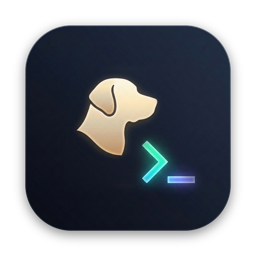
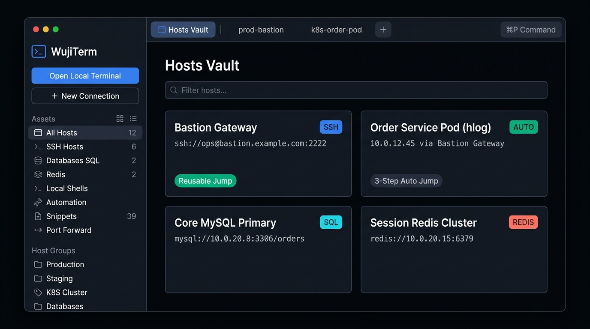
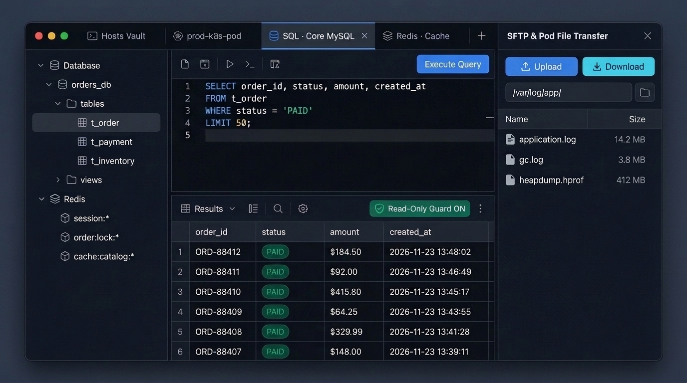

<div align="center">



# WujiTerm（无极终端）

**面向现代研发、运维与 SRE 的下一代 GPU 加速智能终端与一体化工作台**

*基于 Rust + `libghostty-vt 1.0` SIMD 内核 + `wgpu` GPU 渲染构建，原生融合 SSH / 多层堡垒机自动化 / K8S 日志排障 / AI 副驾驶 / SQL & Redis 工作台 / 穿透式文件传输*

[](https://github.com/CoolwjSoft/wujiterm/releases)
[](#核心技术架构)
[](#核心技术架构)
[](#6-军工级安全密钥管理与双端云同步)
[](#开源协议)

[界面一览](#界面一览) · [核心特色](#核心功能与特色) · [架构设计](#核心技术架构) · [快捷键速查](#常用快捷键速查) · [安装与使用](#下载与安装) · [CLI 自动化](#wuji-命令行工具)

</div>

---

## 为什么选择 WujiTerm？

在日常研发与线上排障场景中，工程师往往需要同时在 **SSH 终端、跳板机脚本、本地日志分析工具、数据库客户端、Redis 客户端、SFTP 工具、AI 问答窗口** 之间频繁切换，不仅割裂了排障上下文，传统 Electron 套壳终端在面对高吞吐 K8S 日志流时也极易卡顿与高内存占用。

**WujiTerm（无极终端）** 使用纯原生 **Rust** 编写，底层静态链接 Zig 编译的 **`libghostty-vt 1.0`（ReleaseFast + SIMD 加速）** 终端解析引擎，并由 **`wgpu`（Metal / DirectX 12 / Vulkan）** 驱动 120fps GPU 硬件渲染。它把高频研发与运维能力深度整合进一个**零 Electron、低内存占用、空闲 0% CPU 唤醒**的原生桌面应用中：

| 维度 | 传统多工具拼装 / Electron 终端 | WujiTerm（无极终端） |
| :--- | :--- | :--- |
| **渲染与吞吐性能** | Chromium DOM/Canvas，高吞吐日志易掉帧卡顿 | **Rust + `libghostty-vt` SIMD + `wgpu` GPU 加速**，空闲 0% 轮询 |
| **多层堡垒机 & K8S 登录** | 每次手动选节点、输密码、切容器、敲日志命令 | **跳板机可复用继承 + Expect 状态机**，一键直达 Running Pod 并自动 `hlog` |
| **线上日志排障** | 肉眼翻屏、全屏 `grep` 断流、手动贴外部工具格式化 | **实时语法高亮 + 不断流 TraceId 过滤抽屉 + 右键 JSON/SQL/堆栈格式化 + Diff 对比** |
| **数据与文件运维** | 另开 Navicat / Redis Desktop / FileZilla / `rz/sz` | **原生内置 MySQL / PG / ClickHouse / Redis 工作台 + SFTP & 容器管道直传** |
| **AI 深度协同** | 复制报错切浏览器问 AI，容易泄露敏感信息 | **内置 AI 运维副驾驶**，报错自动感知、脱敏发送、自然语言直出 Shell 命令 |
| **安全与多端同步** | 明文配置或绑定第三方云账号 | **系统钥匙串 / 本地主密码 AES-256-GCM 保险库 + 生产高危防火墙 + 端到端加密云同步** |

---

## 界面一览

### 1. 统一主机资产库与跳板机中心（Hosts Vault）
> 一体式沉浸顶栏（合并窗口按钮与标签页）、左侧连接资产分类与主机分组支持自由手动排序、网格/列表视图切换、可复用跳板机继承与多步骤自动化流水线。

<p align="center">
  
</p>

### 2. GPU 智能终端、不断流日志过滤与 AI 运维副驾驶
> 支持任意方向分屏与多窗格广播输入、VS Code 风格日志语法高亮、底部 IDEA Grep Console 同款 `TraceId` 实时日志过滤抽屉，以及右侧 AI 报错根因诊断与修复建议面板。

<p align="center">
  
</p>

### 3. 内置 SQL / Redis 数据工作台与 SFTP / 容器文件直传
> 无需离开终端应用，即可在同一标签页体系内执行 MySQL / PostgreSQL / ClickHouse 查询（带只读安全护栏）、浏览 Redis 命名空间树，并通过右侧抽屉进行 SFTP 或穿透堡垒机容器文件传输。

<p align="center">
  
</p>

---

## 核心功能与特色

### 1. 极致性能终端与一体式现代桌面体验
- **高性能原生内核**：静态集成 `libghostty-vt 1.0`（SIMD 加速），精准支持 TrueColor 24-bit 色彩、宽字符 CJK 完美居中对齐、OSC7 工作目录追踪、鼠标双击选词 / 三击选行、`⌘/Ctrl + 点击` 直接打开链接与选中自动复制。
- **一体式沉浸顶栏**：
  - **macOS**：将原生红黄绿窗口按钮直接融入顶部标签栏同一行，全屏时自动收起留白。
  - **Windows**：移除多余系统标题栏与占高菜单条，左侧提供紧凑 `☰` 级联菜单、右侧内嵌原生手感 `─ / □ / ✕` 控制按钮，完整保留 Win11 圆角、阴影、八方向边缘缩放与 Aero Snap 分屏贴靠。
  - 顶栏空白区域支持直接拖拽移动窗口、双击最大化/还原。
- **灵活的标签页管理**：
  - 支持 **3 种标签栏布局模式**（可配置）：① 单行横向滑动；② 超出后自动折叠至末尾 `▾ 更多 (N)` 下拉菜单；③ 自动换行多行平铺全部可见。
  - 支持**标签页固定（防误关）**、按住拖拽重排顺序、右键批量关闭右侧或其它未固定标签。
  - **顶栏 `+` 按钮双交互**：左击默认打开本地终端，支持自定义配置为一键连接主机库中的指定主机；**右击 `+` 随时弹出可搜索的完整主机列表**，一键直连或将其设为左击默认。
  - 顶栏右侧功能按钮支持逐项自由勾选显隐。
- **自由分屏与广播输入**：支持向右分屏、向下分屏、单窗格临时最大化（Zoom Pane）、多窗格同步广播输入（Broadcast，类似 iTerm2）。

### 2. 主机资产库与多层堡垒机 / K8S 自动化引擎
- **可复用跳板机继承**：将堡垒机 / ECS 跳板机标记为「可作为跳板机复用」后，下游业务主机只需一键关联，即可自动继承账号、加密口令与前置登录步骤（支持「跳板机内跳转 Relay」与「SSH `ProxyJump -J` 隧道」两种模式）。
- **可视化 Expect 自动跳转流水线**：
  - 内置分支状态机，自动处理首次连接指纹确认、口令自动填充、动态菜单选择与登录后的自动执行指令。
  - 支持 `auto:服务名|兜底序号` 智能规则，自动解析堡垒机 / K8S 菜单并优先选择 `Running` 状态的业务容器。
  - 快捷指令库无缝联动：配置自动执行步骤时可直接从快捷指令库选取指令。
- **资产高效组织与手动排序**：
  - 自动发现本地 `~/.ssh/config` 主机与操作系统本地 Shell（Zsh / Bash / PowerShell / CMD）。
  - 支持**卡片网格（Grid）与紧凑列表（List）双视图**、5 种排序模式（自定义顺序 / 名称 A→Z / Z→A / 地址 / 协议类型）。
  - 支持多级目录分组（如 `生产环境/订单服务`）、原地内联重命名分组；**左侧「连接资产」分类与「主机分组」均支持按住拖拽、点击 `⇅ 排序` 上下微调及右键菜单调整顺序**。
- **生产标识与高可用保活**：支持为主机配置 `PROD` 生产环境警示标、断线自动重连倒计时以及防踢心跳保活（Anti-Idle Heartbeat）。

### 3. 研发与 SRE 日志排障工具箱
- **自动日志语法高亮**：自动识别时间戳、`INFO / WARN / ERROR` 日志级别、Java 类名行号、JSON 键值、SQL 关键字、URL 与耗时指标，且不覆盖 `vim` / `htop` / `ls --color` 等应用自身的 ANSI 色彩。
- **不断流实时日志过滤抽屉（Live Log Filter）**：灵感源自 IDEA Grep Console，在 `tail -f` / `kubectl logs -f` 持续刷屏时实时按 `TraceId` 或关键词过滤日志流，支持 `±N` 行上下文展示与多色关键词高亮标签，且不中断底层会话。
- **智能终端交互增强**：
  - **命令块状输出（Blocks）**：将每次执行的命令与输出独立成块，便于单块复制、脱敏分享、折叠筛选与报错定位。
  - **多行智能输入栏**：支持鼠标点击定位光标、多行编辑、命令与路径自动补全菜单，以及跨会话历史命令可视化全文检索。
- **右键一键格式化与解析（Selection Formatters）**：
  - 框选任意终端输出，一键识别并弹窗美化 **JSON**、**带 `?` 占位参数自动绑定的 SQL**、**Java / K8S 异常堆栈根因折叠**、**Cron 表达式与未来触发时间推算**、**Unix 时间戳**、**JWT Token 解码与过期校验**、**URL Query 拆解**、**Base64 编解码**。
  - 支持用户编写零依赖链式 DSL 或 Python / Shell 自定义格式化脚本。
- **双栏报文 Diff 对比器**：一键将选中文本设为基线并与新输出进行双栏差异对比，支持 JSON 按 Key 自动排序去噪对比与 SQL 规范化对比。
- **脱敏安全复制**：一键掩码手机号、身份证号、JWT Token、密码与内网 IP 后再写入剪贴板，发群提单零泄露风险。
- **内置 SRE 应急诊断箱 & 快捷指令库**：预置 Java CPU/内存排查、Linux 网络/磁盘诊断、K8S 常用排查 Playbooks，支持 `{{param}}` 参数化模板弹窗填参执行。

### 4. 深度集成 AI 运维副驾驶（AI Copilot）
- **多模型自由配置**：开箱内置 **DeepSeek、通义千问（Qwen）、OpenAI、智谱 GLM、本地 Ollama** 等主流大模型预设，并支持任意 OpenAI-Compatible 自定义网关，API Key 安全加密存储于密钥库。
- **报错自动感知与一键诊断**：终端命令退出码异常或出现堆栈报错时自动浮现诊断提示，一键唤起 AI 解析根因并生成可直接运行的修复命令。
- **自然语言转 Shell 指令**：用中文描述排障意图（如「找出占用 8080 端口的进程并查看其最近 100 行日志」），自动生成安全精确的 Shell 命令并支持一键回填执行。
- **隐私脱敏护栏**：支持开启「发送前自动脱敏」，确保敏感凭据与业务隐私数据不离开本地。

### 5. 原生 SQL / Redis 数据工作台与穿透式文件传输
- **内置数据库工作台（SQL Studio）**：原生协议直连 **MySQL / PostgreSQL / ClickHouse**，支持 Schema 树浏览、SQL 语法编辑器、结构化结果集表格、导出与**只读模式 / 生产写操作拦截保护**。
- **内置 Redis 工作台（Redis Studio）**：支持命名空间树形聚合浏览（自动按 `:` 分隔折叠海量 Key）、TTL 与类型查看、键值编辑与安全命令执行。
- **双引擎文件传输**：
  - **SFTP 可视化侧边抽屉**：目录浏览、文件大小/权限展示、一键上传与拉取至本地下载目录。
  - **穿透式容器文件直传（PTY Transfer）**：即使目标 K8S 容器或内网机器无法直连 SFTP，也可通过 **ZMODEM (`rz`/`sz`)** 或 **Base64 管道流** 穿透多层跳板机直接完成文件上传与日志包拉取，并实时展示传输进度条。
- **SSH 端口转发隧道管理**：图形化统一管理与一键启停本地转发（`-L`）、远程转发（`-R`）与动态 SOCKS5 代理（`-D`）。

### 6. 军工级安全、密钥管理与双端云同步
- **双模式密钥库（用户自主选择）**：
  - **系统钥匙串（默认）**：原生接入 macOS Keychain 与 Windows Credential Manager，配置文件中仅存 `keychain://...` 占位引用，绝不落盘明文密码。
  - **本地加密保险库**：支持独立主密码保护的 `vault.enc`（**PBKDF2-HMAC-SHA256 + AES-256-GCM** 端到端加密），支持随时锁定/解锁与修改主密码。
- **生产高危命令防火墙（Guardrail）**：在敲下回车执行前实时拦截 `rm -rf`、无 `WHERE` 条件的 `DELETE / UPDATE`、`DROP TABLE`、`kubectl delete`、`FLUSHALL` 等高危指令，强制二次确认防止生产事故。
- **会话录像与审计检索**：支持自动录制完整终端日志（`.log`）与可回放的 Asciinema 录像（`.cast`），内置历史命令审计时间线与全文搜索，支持按保留天数自动清理过期归档。
- **端到端加密备份与多端云同步**：
  - 所有同步数据在本地经 **AES-256-GCM** 加密后上传，云端零明文可见。
  - 支持 **GitHub Gist、GitLab Snippet、WebDAV（坚果云 / Nextcloud 等）、iCloud / OneDrive 共享目录、以及自建 `wuji-sync-server`**，内置三方智能合并冲突检测。

### 7. 个性化视觉定制与自动更新
- **自定义背景图片**：支持选择本地 `.png / .jpg / .jpeg / .webp / .gif / .bmp` 壁纸，提供 **`3% ~ 100%` 不透明度无极滑块 + 终端文字清晰度实时预览框**、后台预计算**毛玻璃高斯模糊**（`0px / 4px / 10px / 20px`，零帧率损耗）、4 种缩放填充模式（`Cover / Contain / Stretch / Center`），可选**全局沉浸（主机库与设置页呈半透明毛玻璃卡片）**或**仅终端会话画布**。
- **丰富的主题与精细字体排版**：内置 20+ 精品终端配色方案（支持白天 / 夜晚 / 跟随系统自动切换与自定义 16 色 ANSI 调色板）；支持配置首选/备用字体、连结字、正常与粗体字重、光标形状与闪烁、WCAG 最低对比度自动提亮及像素级行间距。
- **中英文双语 & 自动更新**：完整简体中文 / English 实时切换；内置版本检查、SHA-256 完整性校验与一键原地自动升级框架。

---

## 核心技术架构

```mermaid
flowchart LR
    subgraph UI["GPU 原生桌面界面 (wuji-app · iced 0.13 + wgpu)"]
        A1["一体式沉浸顶栏<br/>多模式标签 + 自定义 + 按钮"]
        A2["主机资产库 Vault<br/>分组排序 / 跳板机继承"]
        A3["智能终端与排障台<br/>分屏 / Blocks / Live Filter / AI"]
        A4["SQL & Redis 工作台<br/>SFTP & 容器穿透直传"]
    end

    subgraph Engine["高性能核心引擎层 (Pure Rust + Zig SIMD)"]
        B1["wuji-renderer<br/>120fps GPU 文本与背景叠层渲染"]
        B2["wuji-vt + libghostty-vt 1.0<br/>SIMD 加速 VT100/XTerm 解析"]
        B3["wuji-pty<br/>macOS PTY / Windows ConPTY"]
        B4["wuji-automation<br/>Expect 状态机 / 触发器 / 日志高亮 / 加密库"]
    end

    subgraph Data["数据、同步与自动化生态"]
        C1["wuji-data<br/>MySQL / PG / ClickHouse / Redis"]
        C2["wuji-config<br/>toml_edit 无损持久化 & 热重载"]
        C3["wuji-sync & wuji-sync-server<br/>AES-256-GCM 端到端加密同步"]
        C4["wuji CLI<br/>命令行管理 & 无头自动化验证"]
    end

    UI --> Engine
    UI --> Data
    Engine --> Data
```



---

## 常用快捷键速查

| 功能 | macOS | Windows |
| :--- | :--- | :--- |
| 唤起全局命令面板（主机 / 片段 / 主题 / 操作） | `⇧⌘P` | `Ctrl+Shift+P` |
| 打开 / 返回主机库主页 | `⌘K` | `Ctrl+Shift+K` |
| 新建本地终端标签页 | `⌘T` | `Ctrl+Shift+T` |
| 关闭当前分屏 / 标签页 | `⌘W` | `Ctrl+Shift+W` |
| 向右分屏 / 向下分屏 | `⌘D` / `⇧⌘D` | `Ctrl+Shift+D` / `Ctrl+Shift+E` |
| 最大化 / 还原当前分屏（Zoom Pane） | `⇧⌘↵` | `Ctrl+Shift+↵` |
| 开启 / 关闭多分屏广播输入 | `⇧⌘I` | `Ctrl+Shift+I` |
| 屏幕文本检索 | `⌘F` | `Ctrl+Shift+F` |
| 开启 / 关闭实时日志过滤抽屉（TraceId 视图） | `⌘L` | `Ctrl+Shift+L` |
| 唤起 AI 运维副驾驶 | `⌘I` | `Alt+I` |
| 格式化选中内容（JSON / SQL / 堆栈 / Cron 等） | `⌥⇧F` | `Alt+Shift+F` |
| 脱敏复制选中内容 | `⌥⇧C` | `Alt+Shift+C` |
| 切换自动折行 / 单行横向滚动 | `⌥Z` | `Alt+Z` |
| 导出当前屏幕日志（`.log`） | `⌘S` | `Ctrl+Shift+S` |
| 打开设置中心 | `⌘,` | `Ctrl+,` |

---

## `wuji` 命令行工具

WujiTerm 配套提供独立的 `wuji` CLI 工具，方便 DevOps 脚本与 AI Coding Agent 以声明式方式管理终端资产与自动化流程：

```bash
# 查看所有已配置主机与分组
wuji host list

# 添加 SSH / 跳板机 / K8S 自动化主机并加密保存凭据
wuji host add --name "订单服务 Pod" --via bastion-k8s --step "shell->hlog"

# 在终端外以无头模式验证某台主机的自动化登录链路是否畅通
wuji verify --profile prod-order-pod

# 导出 AES-256-GCM 加密备份包或触发云同步推送
wuji sync push
```

---

## 下载与安装

请前往 [Releases 页面](https://github.com/CoolwjSoft/wujiterm/releases) 下载对应平台的最新安装包：

- **macOS（Apple Silicon M1/M2/M3/M4 & Intel 通用包）**：
  - 下载 `WujiTerm-<version>-macos-universal.dmg`，双击打开并将 `WujiTerm.app` 拖入 `Applications` 文件夹即可使用。
- **Windows 10 / 11（x86_64 绿色免安装包）**：
  - 下载 `WujiTerm-windows-x86_64.zip`，解压至任意目录，双击运行 `wujiterm.exe` 即可（无需安装运行库）。

### 配置文件路径
所有配置均采用人类可读的 TOML 格式，支持外部编辑器修改并自动热重载：
- **macOS / Linux**：`~/.config/wujiterm/config.toml`
- **Windows**：`%APPDATA%\wujiterm\config.toml`（或 `~/.config/wujiterm/config.toml`）

---

## 开源协议

本项目基于 [MIT License](https://opensource.org/licenses/MIT) 许可协议。欢迎提交 Issue、Feature Request 与使用反馈！
