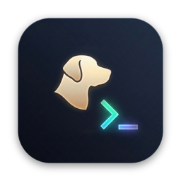
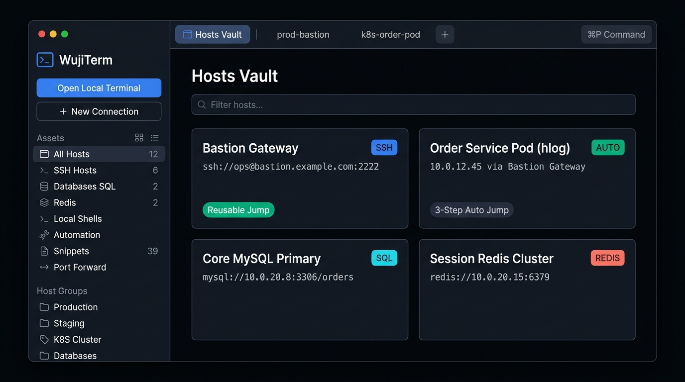
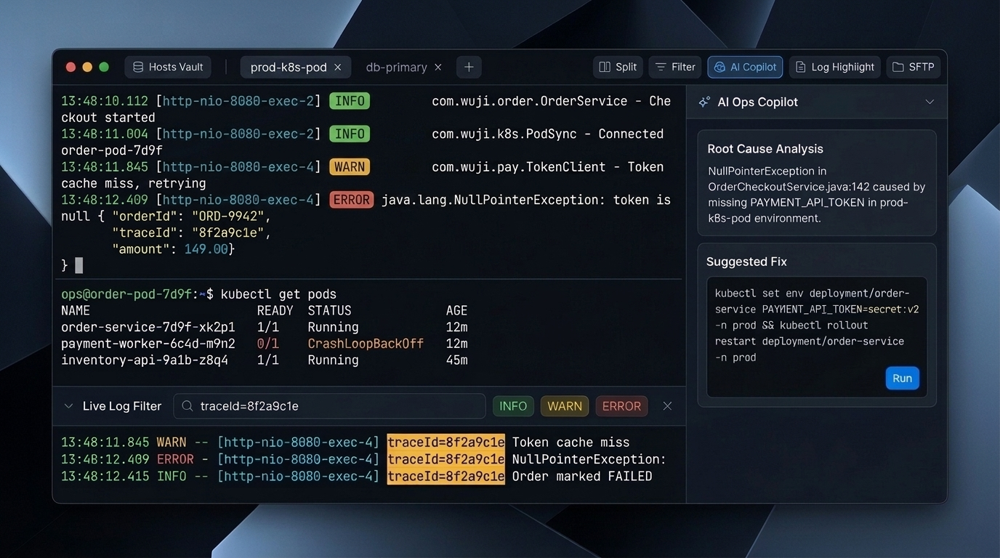
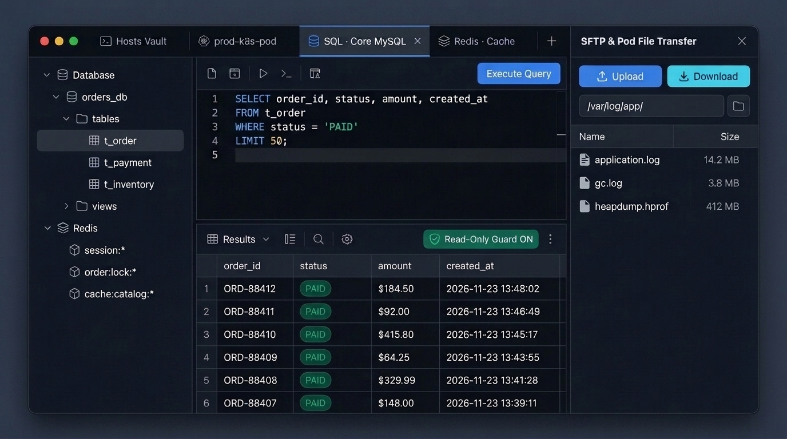

<div align="center">



# WujiTerm

**Next-Generation GPU-Accelerated Smart Terminal & All-in-One Engineering Workbench for Developers, DevOps & SREs**

*Built with native Rust + `libghostty-vt 1.0` SIMD Core + `wgpu` GPU Rendering — unifying SSH, Multi-Hop Bastion Automation, Live Kubernetes Log Diagnostics, Command Blocks, AI Ops Copilot, SQL & Redis Data Studio, SFTP/Pod File Transfer, and E2EE Cloud Sync*

[](https://github.com/CoolwjSoft/wuji-term/releases)
[](#core-architecture)
[](#core-architecture)
[](#7-security-audit--end-to-end-encrypted-cloud-sync)
[](#license)

**[简体中文](README.md)** | **English**

[Why WujiTerm](#why-wujiterm) · [Visual Tour](#visual-tour) · [Full Feature Breakdown](#full-feature-breakdown) · [Architecture](#core-architecture) · [Shortcuts](#keyboard-shortcuts) · [CLI & Self-Hosted Sync](#8-wuji-cli--self-hosted-sync-server) · [Installation](#download--installation)

</div>

---

## Why WujiTerm?

During real-world development and production incident response, engineers constantly juggle **SSH clients, jump-host scripts, log viewers, online JSON/SQL formatters, diff tools, database GUIs, Redis browsers, SFTP clients, `rz/sz` utilities, and AI chat tabs**. Meanwhile, traditional Electron-based terminals consume heavy memory and drop frames under high-throughput Kubernetes log streams.

**WujiTerm** eliminates browser bloat entirely. Written in pure native **Rust**, statically linked with Zig-compiled **`libghostty-vt 1.0` (ReleaseFast + SIMD)**, and rendered via **`wgpu` (Metal / DirectX 12 / Vulkan)** with an **event-driven zero-polling architecture (0% idle CPU / 0% idle GPU / 0 background wakeups)**, WujiTerm consolidates the entire engineering & SRE workflow into one ultra-fast, secure native desktop app:

| Dimension | Fragmented Tools / Electron Terminals | WujiTerm |
| :--- | :--- | :--- |
| **Rendering & Efficiency** | Chromium DOM/Canvas, stutters on heavy logs | **Rust + `libghostty-vt` SIMD + `wgpu` 120fps GPU**, 0% idle polling |
| **Multi-Hop Bastion & K8S** | Manual node selection, repeated passwords, shifting Pod IDs | **Reusable Jump Host inheritance + Expect FSM + `auto:service` Running Pod selector** |
| **Live Log Troubleshooting** | Manual scrolling, stream-breaking `grep`, pasting logs online | **Log syntax highlight + non-blocking `TraceId` Live Filter + 8 built-in formatters + Diff + Sanitized Copy** |
| **Modern Terminal Ergonomics** | Hard to edit long commands or isolate command outputs | **Command Blocks + Multi-line Smart Composer + Autocomplete + Visual Cross-Session History** |
| **Database & File Ops** | Separate Navicat / Redis GUI / FileZilla / `lrzsz` apps | **Built-in MySQL / PG / ClickHouse / Redis Studio + SFTP & Bastion-penetrating Pod Transfer** |
| **AI Ops Collaboration** | Copy-pasting stack traces to web chats, risking token leaks | **Built-in Multi-LLM AI Copilot** with auto error detection, pre-send sanitization & NL-to-Shell |
| **Security & Sync** | Plaintext configs or locked-in proprietary cloud accounts | **OS Keychain / Local AES-256-GCM Vault + Prod Command Guardrail + Multi-Backend E2EE Sync** |

---

## Visual Tour

### 1. Unified Hosts Vault & Bastion Hub
> Single-row immersive titlebar merging native window controls with open tabs, manually reorderable sidebar Assets & Host Groups, Grid/List views, reusable jump-host inheritance, and multi-step Expect automation pipelines.

<p align="center">
  
</p>

### 2. GPU Smart Terminal, Live Log Filter & AI Ops Copilot
> Arbitrary split panes with multi-pane broadcast input, VS Code-style real-time log syntax highlighting, bottom IDEA Grep Console-inspired `TraceId` Live Log Filter drawer, and right-side AI root-cause diagnosis & fix panel.

<p align="center">
  
</p>

### 3. Integrated SQL / Redis Data Studio & SFTP / Pod File Transfer
> Query MySQL, PostgreSQL, ClickHouse, and Redis natively inside the same tab strip (with Read-Only Guardrails & Redis namespace tree), paired with the SFTP & bastion-penetrating Pod file transfer slide-over drawer.

<p align="center">
  
</p>

---

## Full Feature Breakdown

### 1. High-Performance Terminal Core & Modern Desktop UX

- **`libghostty-vt 1.0` SIMD Engine + `wgpu` GPU Rendering**
  - Full 24-bit TrueColor support, pixel-accurate centered wide CJK glyphs, coalesced ASCII draw batching, and live OSC7 working directory tracking.
  - **Zero-Polling Reactive Architecture**: Driven by `tokio::Notify` and native `FSEvents`, achieving **0% idle CPU / 0% idle GPU** while coalescing high-throughput PTY output into smooth 120fps frames.
- **Unified Single-Row Immersive Titlebar (macOS & Windows)**
  - **macOS**: Native red/yellow/green traffic lights embedded directly inside the left side of the single-row tab bar with pixel-accurate vertical alignment; automatically collapses left inset in native macOS Full Screen.
  - **Windows**: Eliminates redundant OS titlebars and extra menu rows into one unified header — compact `☰` cascading menu button on the far left, authentic `─ / □ / ✕` caption buttons on the far right, preserving native Windows 11 rounded corners, DWM shadow, 8-edge border resizing, and Aero Snap.
  - Drag any empty header space to move the window; double-click to maximize/restore (right-click for native Windows system menu).
- **Flexible Tab Management, Pinning & Configurable `+` Button**
  - **3 Configurable Tab Bar Modes**: (1) Single-row horizontal scroll; (2) Trailing `▾ More (N)` overflow dropdown (automatically keeps the active tab visible); (3) Automatic multi-row wrap so all open tabs stay visible.
  - **Tab Pinning & Drag-to-Reorder**: Pin critical production sessions to prevent accidental closure, drag tabs to reorder, and right-click to close other/right unpinned tabs.
  - **Dual-Action `+` Button**: Left-click defaults to opening a Local Terminal and can be configured (in Interface Settings or directly from the popover) to open any specific host from your Vault; **right-click `+` anytime to pop up a searchable Host List** for 1-click connection or setting a new left-click default.
  - **Customizable Right Toolbar**: Independently toggle visibility of Command Palette, Split Right/Down, Command Blocks, Live Filter, AI Copilot, Line Wrap, Log Highlight, Snippets, Search, Files (SFTP + Pod Transfer), and standalone `rz/sz` buttons.
- **Long-Line Log Modes & Precision Mouse Ergonomics**
  - **Line Wrap / Single-Line Horizontal Scroll (`⌥Z` / `Alt+Z`)**: Single-line mode features a smooth bottom scrollbar, trackpad horizontal swipe, and `Shift + Wheel` scrolling for wide JSON and stack traces without breaking lines.
  - **IDE-Grade Mouse Interaction**: Click anywhere on the command line to move the shell cursor with minimal arrow keystrokes (CJK & soft-wrap aware), double-click to select words, triple-click to select lines, optional copy-on-select, and `⌘/Ctrl + Click` to open URLs.
- **Arbitrary Split Panes, Pane Zoom & Broadcast Input**
  - Nested horizontal/vertical splits, temporary single-pane Zoom (`⇧⌘↵` / `Ctrl+Shift+↵`), and iTerm2-style multi-pane Broadcast Input (`⇧⌘I` / `Ctrl+Shift+I`).
- **Global Command Palette (`⇧⌘P` / `Ctrl+Shift+P`) & Editable Right-Click Menu**
  - Instant keyboard fuzzy search across all hosts, databases, Redis instances, snippets, diagnostic playbooks, color schemes, and actions.
  - Fully customizable terminal context menu (add/remove items, reorder, insert separators, bind custom command actions).

---

### 2. Hosts Vault & Multi-Hop Bastion / Kubernetes Automation

- **All Connection Assets in One Vault**
  - Manage **SSH hosts, Bastion/Jump hosts, Expect automation pipelines, Local Shells (auto-discovered Zsh / Bash / PowerShell / CMD), MySQL / PostgreSQL / ClickHouse databases, and Redis caches**, plus automatic `~/.ssh/config` discovery.
- **Reusable Jump Host Inheritance**
  - Flag any Bastion or ECS Jump Host as **"Reusable as Jump Host"** — downstream hosts inherit its credentials, encrypted password, and pre-login steps with one click (supporting both **in-session Relay** and **SSH `ProxyJump -J` tunnel** modes).
- **Visual Expect State Machine & Smart Running Pod Selection**
  - Visual multi-step automation builder handling host-key verification, secret injection, multi-level bastion menus, conditional branching, and post-login commands.
  - **`auto:service|fallback` Dynamic Matcher**: Parses bastion/K8S menus on the fly and automatically prefers `Running` pods by service name — immune to index shifts after deployments.
  - **Smart Prompt Detection & Snippet Picker**: Write `shell` to match macOS `zsh` (`%`), Linux (`#`/`$`), Windows PowerShell/CMD (`>`), and Oh-My-Zsh (`➜`/`❯`) prompts automatically; write `now` for immediate dispatch; pick commands directly from your Snippets library.
- **Multi-View Organization & Full Manual Reordering**
  - Switch between **Grid Cards** and **Compact List** views with 5 sort modes (Custom order with `↑/↓`, Name A→Z / Z→A, Address, Protocol).
  - Support nested `/`-separated folder groups (e.g. `Prod/OrderService`) and inline group renaming.
  - **Manual Reordering for Sidebar Assets & Host Groups**: Reorder both "Connection Assets" and "Host Groups" via **press-and-hold drag-and-drop**, **`⇅ Sort` inline `↑/↓` controls**, or **right-click context menus** (Move Up/Down/Top/Bottom); group order syncs globally across sidebar, filter pills, and host sections.
- **Production Safety & High Availability**
  - Host-level **`PROD` warning badge**, **Auto-Reconnect** with countdown & cancel, **Anti-Idle Heartbeat** to prevent bastion timeouts, and configurable **Launch Behavior** (Hosts Vault / Local Terminal / Specific Host).

---

### 3. Developer & SRE Diagnostics Workbench

- **Smart Terminal: Command Blocks & Multi-Line Input Composer**
  - **Command Blocks**: Automatically groups each command and its output into an isolated block with 1-click copy, sanitized copy, in-block filter, collapse, and 1-click AI error diagnosis.
  - **Multi-Line Smart Composer**: Supports mouse cursor editing, visual cross-session command history search, and autocomplete from snippets, audit history, and remote directory listings.
- **Real-Time Log Syntax Highlighting**
  - Highlights timestamps, `INFO / WARN / ERROR / FATAL` levels, Java class/line references, JSON keys, SQL keywords, URLs, and latencies while respecting explicit ANSI colors in interactive TUIs (`vim`, `htop`, `ls --color`).
- **Non-Blocking Live Log Filter Drawer (`TraceId` Focus View)**
  - Inspired by IDEA Grep Console: filter continuously streaming `tail -f` / `kubectl logs -f` output by `TraceId`, keyword, or regex with `±N` context lines and color-coded highlight chips — without interrupting the live terminal stream.
- **Output Trigger Engine**
  - Dual `Aho-Corasick` + `Regex` engine watching live terminal output to trigger custom highlights, desktop notifications, or automated responses (with cooldown debouncing and optional confirmation gates).
- **8 Built-In Selection Formatters + Custom Formatter Studio**
  - Select any terminal text and right-click to pretty-print & inspect:
    1. **JSON** pretty-printer;
    2. **SQL Formatter with `?` Parameter Binding** (reconstructs runnable SQL from MyBatis/JDBC `Preparing:` + `Parameters:` logs);
    3. **Java / K8S Stacktrace Cleaner** (highlights root cause, folds Spring/Netty/Tomcat framework noise);
    4. **Cron Expression Inspector** (human-readable schedule + next 5 fire times for both Linux 5-field & Spring 6-field syntax);
    5. **Unix Timestamp Converter** (seconds & milliseconds, local & UTC);
    6. **JWT Token Decoder** (Header/Payload inspection & expiration status);
    7. **URL Decoder & Query Parameter Table**;
    8. **Base64 Decoder / Encoder**.
  - **Custom Formatter Studio**: Author zero-dependency chained Pipeline DSL rules (e.g. unwrap nested JSON, generate `SQL IN (...)` clauses) or plug in local Python / Shell scripts.
- **Side-by-Side Diff Inspector**
  - Set any selection as Baseline (Diff A) and compare side-by-side with Diff B, featuring **recursive key-sorted JSON diff**, normalized SQL diff, and line-level text diff.
- **Sanitized Copy (`⌥⇧C` / `Alt+Shift+C`)**
  - Automatically masks mobile numbers, ID numbers, emails, JWT tokens, passwords, and internal IPs before copying to clipboard.
- **Parameterized Snippets & Built-In SRE Playbooks**
  - Supports `{{param}}` templates that auto-prefill from your current terminal selection, alongside built-in Java (CPU/Thread/GC), Linux (Network/Disk), and K8S diagnostic playbooks.

---

### 4. Built-In AI Ops Copilot

- **Multi-Provider LLM Support**: Built-in presets for **DeepSeek, Qwen, OpenAI, Zhipu GLM, and local Ollama**, plus any OpenAI-Compatible endpoint and custom system prompts; API keys are stored encrypted in the secret vault.
- **Auto Error Detection & Stacktrace Diagnosis**: Automatically detects failed commands and exception traces, surfacing a lightweight inline banner for 1-click root-cause analysis and executable fix commands.
- **Natural Language to Shell**: Describe what you need in plain language to generate safe POSIX/Linux/K8S commands ready to execute.
- **Pre-Send Privacy Sanitization**: Optionally mask tokens, secrets, and PII automatically before sending context to cloud models.

---

### 5. Native SQL / Redis Data Studio, File Transfer & Tunnels

- **Built-In SQL Studio**: Native protocol clients for **MySQL, PostgreSQL, and ClickHouse** — browse schemas, run queries in a syntax-highlighted editor, inspect results in a structured table, jump to CLI, and enforce **Read-Only / Production Write Guardrails**.
- **Built-In Redis Studio**: Native RESP client with delimiter-grouped **Namespace Tree** for large keyspaces, TTL/type inspection, value editing, and `FLUSHDB / FLUSHALL` safety blocks.
- **Dual-Engine File Transfer**:
  - **SFTP Slide-Over Explorer**: Browse remote directories, upload local files, and download directly to your Downloads folder.
  - **Bastion-Penetrating Pod Transfer (PTY Transfer)**: Transfer files across multi-hop bastions into isolated K8S pods without direct SFTP access using **Base64 Pipe** or **ZMODEM (`rz` / `sz`)**, complete with live progress bar and cancellation.
- **Visual SSH Port Forwarding**: Manage and toggle `-L` (Local), `-R` (Remote), and `-D` (SOCKS5) SSH tunnels from one dashboard.

---

### 6. Visual Personalization, Typography & Auto-Update

- **Custom Background Images & Frosted Blur**
  - Pick any local `.png / .jpg / .jpeg / .webp / .gif / .bmp` image (direct native `comdlg32.dll` picker on Windows with zero scripting child processes).
  - Features a **3%–100% live opacity slider + real-time terminal readability preview**, pre-computed **Gaussian blur** (`0px / 4px / 10px / 20px` with 0% FPS overhead during scrolling), 4 fit modes (`Cover / Contain / Stretch / Center`), and **Global Immersive (translucent frosted cards)** vs **Terminal Only** scope.
- **Color Schemes & Day/Night Mode**: 20+ built-in themes, Light/Dark/System Auto switching, and a custom 16-color ANSI palette editor.
- **Precision Typography**: Primary & fallback fonts, ligatures, normal/bold font weights, cursor shape & blink, **WCAG 2.1 minimum contrast enforcement**, pixel line spacing, and unified CJK font rendering on Windows.
- **Bilingual UI & Auto-Updater**: Instant English / 简体中文 switching; built-in update checker supporting custom manifest JSON and GitHub/GitLab Releases with **SHA-256 verification** and 1-click in-place upgrades.

---

### 7. Security, Audit & End-to-End Encrypted Cloud Sync

- **Dual Secret Vault Backends (User Choice)**
  - **OS Keychain (Default)**: Native macOS Keychain & Windows Credential Manager (`keychain://...` references only — zero plaintext passwords in config files).
  - **Local Encrypted Vault**: Master-password protected `vault.enc` encrypted with **PBKDF2-HMAC-SHA256 + AES-256-GCM**, with lock/unlock, password rotation, and optional OS Keychain auto-unlock.
- **Production Command Guardrail**: Intercepts high-risk commands (`rm -rf`, `mkfs`, `dd`, unqualified `DELETE / UPDATE`, `DROP TABLE`, `kubectl delete`, `FLUSHALL`, and custom regex rules) before execution with a mandatory confirmation modal.
- **Session Recording & Audit Search**: Records plain `.log` transcripts and replayable Asciinema `.cast` recordings, with full-text command audit search and configurable retention cleanup.
- **End-to-End Encrypted Backup & Multi-Backend Sync**: Export/import **AES-256-GCM** encrypted vault snapshots or sync automatically via **GitHub Gist, GitLab Snippet, WebDAV (Nextcloud / Jianguoyun), iCloud / OneDrive shared folders, or self-hosted `wuji-sync-server`** with 3-way smart merge conflict detection across macOS & Windows.

---

## Core Architecture

```mermaid
flowchart LR
    subgraph UI["Native GPU Desktop App (wuji-app · iced 0.13 + wgpu)"]
        A1["Unified Immersive Header<br/>3 Tab Modes / Pin & Drag / Custom + Button"]
        A2["Hosts Vault<br/>Grid & List / Manual Reorder / Jump Inheritance"]
        A3["Smart Terminal & SRE Suite<br/>Splits / Blocks / Live Filter / Diff / AI Copilot"]
        A4["SQL & Redis Studio<br/>SFTP & Pod Transfer / SSH Tunnels"]
    end

    subgraph Engine["High-Performance Core (Pure Rust + Zig SIMD)"]
        B1["wuji-renderer<br/>120fps GPU Text / Wallpaper Blending / WCAG Contrast"]
        B2["wuji-vt + libghostty-vt 1.0<br/>SIMD-Accelerated VT100/XTerm Parser"]
        B3["wuji-pty<br/>macOS PTY / Windows ConPTY"]
        B4["wuji-automation<br/>Expect FSM / Triggers / Log Highlight / Encrypted Vault"]
    end

    subgraph Data["Data, Sync & Automation Ecosystem"]
        C1["wuji-data<br/>Native MySQL / PG / ClickHouse / Redis"]
        C2["wuji-config<br/>Lossless toml_edit Persistence & Hot Reload"]
        C3["wuji-sync & wuji-sync-server<br/>AES-256-GCM E2EE 3-Way Smart Sync"]
        C4["wuji CLI<br/>Declarative Workflows / AI Guide / Headless Verify"]
    end

    UI --> Engine
    UI --> Data
    Engine --> Data
```



---

## Keyboard Shortcuts

| Action | macOS | Windows |
| :--- | :--- | :--- |
| Global Command Palette (Hosts / Snippets / Themes / Actions) | `⇧⌘P` | `Ctrl+Shift+P` |
| Open / Return to Hosts Vault | `⌘K` | `Ctrl+Shift+K` |
| New Local Terminal Tab | `⌘T` | `Ctrl+Shift+T` |
| Close Active Pane / Tab | `⌘W` | `Ctrl+Shift+W` |
| Split Pane Right / Down | `⌘D` / `⇧⌘D` | `Ctrl+Shift+D` / `Ctrl+Shift+E` |
| Zoom / Restore Active Split Pane | `⇧⌘↵` | `Ctrl+Shift+↵` |
| Toggle Broadcast Input to All Panes | `⇧⌘I` | `Ctrl+Shift+I` |
| Find in Terminal Output | `⌘F` | `Ctrl+Shift+F` |
| Toggle Live Log Filter Drawer (`TraceId` View) | `⌘L` | `Ctrl+Shift+L` |
| Open AI Ops Copilot | `⌘I` | `Alt+I` |
| Format Selection (JSON / SQL / Stacktrace / Cron / etc.) | `⌥⇧F` | `Alt+Shift+F` |
| Sanitized Copy (Mask PII / Tokens) | `⌥⇧C` | `Alt+Shift+C` |
| Toggle Line Wrap / Horizontal Scroll | `⌥Z` | `Alt+Z` |
| Export Screen Log (`.log`) | `⌘S` | `Ctrl+Shift+S` |
| Zoom Font In / Out / Reset | `⌘+` / `⌘-` / `⌘0` | `Ctrl++` / `Ctrl+-` / `Ctrl+0` |
| Open Settings Center | `⌘,` | `Ctrl+,` |

---

## 8. `wuji` CLI & Self-Hosted Sync Server

WujiTerm ships with two standalone companion binaries for automation and private deployment:

### 1. `wuji` CLI (DevOps & AI Coding Agent Friendly)
```bash
# List all configured hosts and groups
wuji host list

# Add an SSH / Bastion / K8S automated host profile with encrypted credentials
wuji host add --name "Order Service Pod" --via bastion-k8s --step "shell->hlog"

# Verify an Expect login pipeline end-to-end in headless mode
wuji verify --profile prod-order-pod

# Print structured JSON schema & usage guide for AI Coding Agents
wuji ai-guide

# Declaratively apply a batch workflow JSON spec
wuji apply --file workflow.json

# Push / pull AES-256-GCM end-to-end encrypted cloud sync snapshots
wuji sync push
wuji sync pull
```

### 2. `wuji-sync-server` (Lightweight Self-Hosted Sync Server)
Deploy a single zero-dependency `wuji-sync-server` binary inside your private intranet (with Bearer Token authentication and versioned snapshot history) for 100% self-sovereign end-to-end encrypted sync between macOS and Windows workstations.

---

## Download & Installation

Download the latest release for your platform from the [Releases Page](https://github.com/CoolwjSoft/wuji-term/releases):

- **macOS (Universal Binary — Apple Silicon M1/M2/M3/M4 & Intel)**:
  - Download `WujiTerm-<version>-macos-universal.dmg`, open it, and drag `WujiTerm.app` into `Applications`.
- **Windows 10 / 11 (`x86_64` Portable)**:
  - Desktop App: Download `WujiTerm-windows-x86_64.zip`, extract anywhere, and run `wujiterm.exe` (zero external runtime dependencies).
  - CLI & Sync Server: Download `WujiTerm-cli-tools-windows-x86_64.zip` (`wuji.exe` + `wuji-sync-server.exe`).

### Configuration File Path
All settings are stored in human-readable TOML with lossless edits and automatic live hot-reload:
- **macOS / Linux**: `~/.config/wujiterm/config.toml`
- **Windows**: `%APPDATA%\wujiterm\config.toml` (or `~/.config/wujiterm/config.toml`)

---

## License

Licensed under the [MIT License](https://opensource.org/licenses/MIT). Issues, feature requests, and feedback are warmly welcome!
